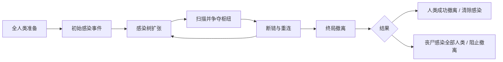
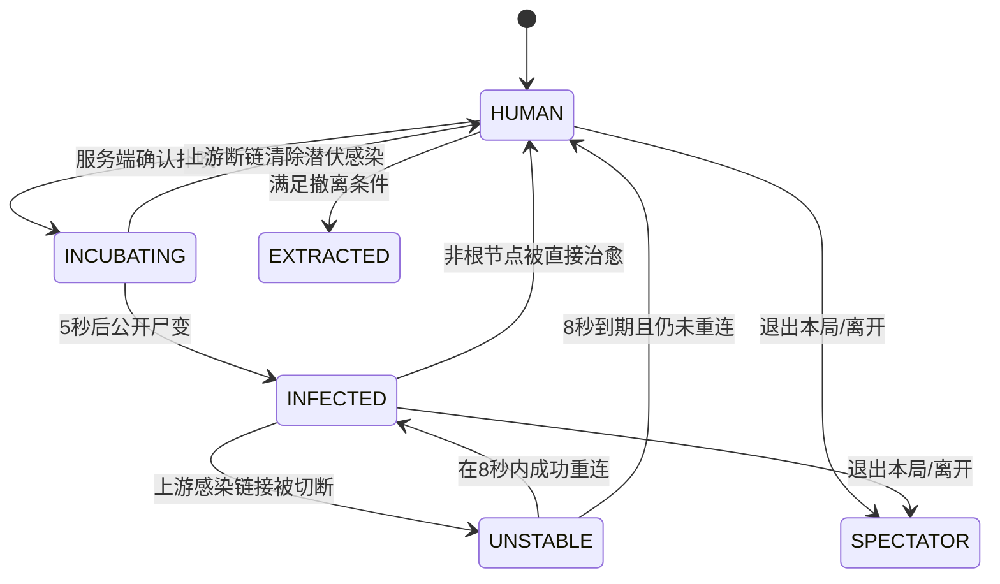

# 《断链》BREAK THE CHAIN
## Game Design Bible V1.0｜完整玩法与系统设计圣经

> **项目代号**：BREAK THE CHAIN /《断链》  
> **文档版本**：V1.0（可执行设计基线，尚未经过真实玩家验证）  
> **编制日期**：2026-10-24  
> **目标平台**：Roblox（PC + 手机横屏优先；平板兼容）  
> **开发栈**：Roblox Studio / Luau / Rojo / Git / Codex 或 Claude  
> **核心模式**：多人短局，动态人类—丧尸阵营转换，感染树争夺与连锁逆转  
> **对局规模**：**最少 4 人可以开局，单局最多 24 人**；2～3 人仅进入训练/等待，不进入正式结算  
> **默认时长**：随人数动态采用 6 / 7 / 8 分钟  
> **商业模式**：免费体验；后续以不影响胜负的外观、动作、特效为主  
> **配套文档**：`断链_BREAK_THE_CHAIN_视觉圣经_V1.0.md`  
> **文档用途**：交付给策划、程序、AI Coding Agent、关卡、美术、QA，用于制作第一版可玩的 Roblox 游戏。

---

# 0. 阅读须知与决策约定

本文件以**能够开发、能够测试、能够修改**为优先级，不是宣传文案；文中数字均为**建议的首次实验参数**，并非已经验证的最佳平衡值。不要把它们说成 Roblox 官方要求或行业平均值。

## 0.1 决策层级

| 标识 | 含义 | 执行要求 |
|---|---|---|
| `LOCKED` | 用户已经确认或首版不可妥协的设计方向 | 未经产品负责人批准不得更改 |
| `BASELINE` | V1.0 暂定的默认实现 | 必须实现为可配置项，允许经过测试改动 |
| `EXPERIMENT` | 仅用于实验或 A/B 的想法 | 不得未经验证加入 P0 正式玩法 |
| `FUTURE` | 后续候选功能 | 首版不做 |

## 0.2 已锁定设计（LOCKED）

1. 游戏名暂用《断链》/ BREAK THE CHAIN。
2. 核心玩法为**开始时所有玩家都是人类；出现被感染者后，人类和丧尸玩家实时对抗**。
3. **玩家被咬后不会退出对局，而是转换阵营**；丧尸目标是感染所有未撤离的人类。
4. 感染记录玩家间的传播父子关系，形成**可断裂的感染树**。
5. 人类可以治愈非零号关键感染者，触发下游分支断联；丧尸可以争取重连。
6. **人数不足也能开局，单局最多 24 人**。不能依赖“必须凑满 24 人”才能玩。
7. 目标是短局、多人参与、能连续重开，不将首版做成大型开放世界求生。
8. 与视觉圣经一致：风格化半写实、非血腥、状态清晰、手机可读、24 人压力预算。

## 0.3 本版确定的可调基线（BASELINE）

| 参数 | 默认值 | 说明 |
|---|---:|---|
| `MinPlayersRanked` | 4 | 4 人可进行正式局，非要求所有服务器只容纳 4 人 |
| `MaxPlayers` | 24 | 单场上限，由 Roblox Place 上限设置配合代码检查 |
| `LobbyWaitSeconds` | 30 | 达到开局下限后候场倒计时；大厅满人可缩短 |
| `PreparationSeconds` | 20 | 开局所有人类的短准备阶段 |
| `IncubationSeconds` | 5 | 感染已生效但尚未公开尸变的潜伏期 |
| `DisconnectSeconds` | **8** | 断联者的重连窗口 |
| `ReconnectHoldSeconds` | 1.0 | 靠近稳定感染者并持续交互以重新连接 |
| `CureChannelSeconds` | 2.0 | 持有解药接近稳定感染者时的注射时间 |
| `CuredImmunitySeconds` | 7 | 解除感染后短暂无敌于再次感染，防止往返刷转换 |
| `ExtractionWindowSeconds` | 90 | 对局最后 90 秒是撤离阶段 |
| `MaxNPCCrowdSeed` | 2 | 初始感染事件专用的受控 NPC，不做 NPC 尸海 |
| `DefaultPerspective` | 第三人称 | 手机与 Roblox Avatar 适配优先 |

> **优先级冲突处理**：本文件拥有*玩法数值、阵营权限、胜负与状态机*的定义权；视觉圣经拥有*美术、颜色、角色外观、UI 风格与特效表现*的定义权。如两者冲突，先确定真实玩法，再修改视觉实现，**绝不允许美术表现改变服务端判定**。

---

# 1. 游戏是什么——一页产品定义

## 1.1 一句话 Pitch

**一群人试图逃离被感染的城市；被咬的队友会变成丧尸，但只要救回关键感染者，就可能让一整条尸群感染链瓦解。**

推广文案候选：

- 中文：**“你感染了一队人？我救回一个，整队都可能倒戈。”**
- 英文：**“Infect the squad. Break the chain. Turn the match around.”**

禁止将宣传描述为“自由 AI 丧尸学习”“开放世界末日生存”“几百人大逃杀”——这些不属于首版能力。

## 1.2 类型与玩家承诺

- **主品类**：多人生存追逐 / Infection PvP / 轻度阵营策略。
- **体验关键词**：朋友变敌人、局势突然反转、短局追逐、营救关键人物、感染关系博弈。
- **每分钟行为**：移动、搜索路线、追击/规避、协作、扫描、抢解药、扑咬、救治、断联、重连、撤离。
- **单局内进展**：人类人数下降→感染网络扩张→重点节点出现→断链→争夺重连→终局撤离。
- **局外进展**：角色外观、称号、档案、战绩、非战力性的表现收集。

## 1.3 四个设计支柱

| 支柱 | 玩家感受 | 判断标准 |
|---|---|---|
| `FAST` 快速进入冲突 | 不等很久就能跑、咬、救人 | 第一局 ≤90 秒应出现感染或救援事件 |
| `REVERSAL` 阵营反转 | 人类、丧尸都有翻盘空间 | 断链和重连可以改变对局的胜负走势 |
| `AGENCY` 双方自主性 | 被感染不是淘汰，断联也不是被控制看动画 | 各状态都有实时可做的操作和选择 |
| `READABLE` 一眼看懂 | 手机端追逐时也懂自己和别人的公开状态 | 玩家不必研究完整图论才能玩懂 |

## 1.4 明确不做

- 不做对战属性付费、装备碾压、永久攻击力升级。
- 不做首版 50～100 人单局；不依赖超大 NPC 尸潮。
- 不做复杂枪械弹道和枪战伤害系统。
- 不做无限刷材料、饥饿值、烹饪、开放世界采集、长线盖基地。
- 不做让丧尸实际在线学习玩家动作的大模型 AI。
- 不做初期 6 种职业、15 种丧尸类型、多张付费地图。
- 不做局内必需语音交流；不开启语音的玩家应能完整游玩。

---

# 2. 目标玩家、产品定位与竞争差异

## 2.1 目标玩家

**主目标**：喜欢 Roblox 多人轻竞技、恐怖但不过度血腥、朋友一起玩的手机/PC 玩家。年龄与可触达群体最终取决于 Roblox 正式的内容成熟度标注和发布资格。

**玩家画像（设计假设）**：

1. **独自加入玩家**：必须一局内快速找到目标，不依赖认识队友。
2. **2～4 人好友小队**：重视一起跑、一起救、互相感染的搞笑与紧张。
3. **连续刷局玩家**：愿意为“再翻一次盘”连续玩 2～3 局。
4. **短视频观众**：看懂“红色感染队伍突然断链变黄，然后部分变绿”的高光。

## 2.2 与成熟 Infection 模式的主要差别

普通 Infection 模式的状态往往单向累积：`人类 -> 感染者`。本项目的核心创新**组合**是：

```text
普通玩法：人类 --被咬--> 丧尸（基本不可逆）
《断链》：人类 --被咬--> 潜伏 --公开尸变--> 稳定丧尸
                         ^                         |
                         |      关键节点被治愈      |
                   恢复人类 <-- 断联8秒 <-- 子树断裂
                                      |
                                      +-- 接触稳定丧尸并重连 --> 稳定丧尸
```

我们不声称“阵营感染”“伪装感染”“治愈”分别属于全球原创。**真正待验证的差异化是：感染关系本身成为攻防资源。**

## 2.3 原型通过标准

仅制作感染树并不代表好玩。首版至少需要证明：

- **基本追逐好玩**：不使用断链时，移动、追逐、闪躲已有乐趣。
- **断链值得争夺**：玩家会主动寻找枢纽、保护节点，而非随机使用解药。
- **重连有真实选择**：断联者感到紧张但不无助，救人和救链带来新互动。
- **局势仍可理解**：看不懂树的新人也能跟着 UI 指引完成目标。

---

# 3. 三层核心循环（Core Loops）

## 3.1 秒级：操作反馈（3～15 秒）

| 人类循环 | 丧尸循环 |
|---|---|
| 找掩体 / 看见感染者 → 冲刺或转向 → 拉开距离 → 寻找治疗/撤离机会 | 侦察路线 → 预判人类逃跑方向 → 突袭扑咬 → 建立感染分支 → 转而追下一个目标 |
| 人类获得扫描后 → 评估枢纽 → 集结 → 击退护卫 → 注射 | 丧尸发现本分支有危险 → 护送枢纽 → 拦截治疗者 → 断联后争取重连 |

## 3.2 局级：感染—断链—撤离（6～8 分钟）



## 3.3 局外：邀请—再来一局—成长

```text
看到精彩瞬间 / 被朋友邀请
    ↓
无需额外付费进入 → 4 人可开局
    ↓
体验一次被感染或断链翻盘
    ↓
结算展示“我感染了谁 / 哪条链被切断”
    ↓
领取非战力的外观进度 / 每日挑战
    ↓
与朋友重开 / 分享本局精彩事件
```

> 局外成长不增加局内属性，否则新增玩家难以公平进入短局竞技。

---

# 4. 一局的生命周期与节奏

## 4.1 正式局状态机

| 状态 | 触发 | 玩家可做的事 | 退出条件 |
|---|---|---|---|
| `WAITING` 等待大厅 | 玩家进入 Place | 邀友、练习操作、选择外观 | 在线已准备玩家 ≥4，倒计时完成 |
| `PREPARE` 准备期 | 匹配成功 | 所有人类移动、认路、熟悉交互 | 20 秒到期 |
| `OUTBREAK` 爆发期 | 初始感染 NPC 释放 | 闪避、追击、首个玩家尸变 | 至少 1 个玩家成为感染源 |
| `CONTEST` 链争夺 | 首位玩家感染后 | 扩散感染、扫描、治愈、断链、重连、修复撤离设施 | 进入最后 90 秒 |
| `EXTRACTION` 撤离 | 剩余时间≤90 秒 | 人类冲出口、丧尸阻截 | 达成胜负条件或倒计时归零 |
| `RESULT` 结算 | 服务端发出唯一最终判定 | 看本局感染树复盘与奖励 | 结算倒计时结束、进入下一局 |

**重要**：游戏阶段与玩家状态分离。`INCUBATING` 是玩家状态，不是新的整局阶段；某名玩家在任何阶段被感染，都可能短暂潜伏。

## 4.2 7 分钟中型局示例

| 时间点 | 设计事件 | 情绪目标 |
|---|---|---|
| 0:00～0:20 | 所有人类分散探索，广播宣告感染事故 | 有一点准备时间，但不冗长 |
| 0:20～1:00 | NPC 冲破封锁，咬伤第一个玩家；短暂潜伏再公开转化 | “刚才的队友变了” |
| 1:00～2:30 | 丧尸感染更多人，修复设施与解药争夺开始 | 紧迫感提高 |
| 2:30～5:30 | 人类扫描枢纽并发起救治，丧尸组织保护和重连 | 反复翻盘、形成战术 |
| 5:30～7:00 | 撤离窗口开启，围堵、牺牲与营救 | 高潮与清晰收尾 |
| 7:00 后 | 结果、传播树、短暂结算、快速重赛 | 愿意再玩一局 |

各阶段不强制等到预定时间才允许感染或治愈；这些是节奏目标，而非固定剧本。必须由服务器权威计时。

---

# 5. 动态人数与开局规则（4～24 人）

## 5.1 设计目标

**人数少也能玩、人数多更热闹**。不能因为并发不足让大厅一直空等；也不能把 24 人场景强塞给 4 个人追逐。

| 开局时真人数 N | 最大正式对局时间 | 初始零号感染源 | 需激活的撤离电力节点 | 人类撤离胜利人数 | 地图范围 |
|---:|---:|---:|---:|---:|---|
| 2～3 | 不进入正式局 | 训练 NPC | 训练设施 | 无正式胜负 | 训练场 |
| **4～7** | **6 分钟** | **1** | **1** | **1 人** | 医院 + 中央街口 + 地铁入口 |
| **8～15** | **7 分钟** | **1** | **2** | **2 人** | 增加庭院 / 控制室 |
| **16～24** | **8 分钟** | **2** | **3** | **4 人** | 增加停车楼 / 侧街 / 地铁连廊 |

注意：初始零号感染源数代表**最终可能出现的独立感染根**；不是开局就有丧尸玩家。所有玩家在 PREPARE 期确实都是人类。

## 5.2 等待与新玩家加入

- 大厅中有 4 人时开始 30 秒开局倒计时；等待期继续吸纳新玩家，最多 24 人。
- 2～3 人可以自由练习移动、互动和简单追逐，不创建假的正式对局成绩。
- 满 24 人可提前启动；不能为了人数规模而牺牲足够的准备与加载时间。
- 正式局进行期间新进入的玩家：**在隔离练习区等待下局**，不强行插入本局已建立的感染树。
- 玩家可在大厅主动“下一局继续”；不强制每局离开服务器。
- 首版可使用 Roblox 默认匹配与一个持续运行的单 Place 回合循环；后期再评估分离大厅 / Match Place 与专门队伍匹配。

## 5.3 人数缩放的地图规则

- 小局使用可见、符合世界观的封锁门和坍塌路障关闭侧区，而不是突然出现透明空气墙。
- 不因地图缩小改变位置、碰撞箱和战斗基本规则；只改变开放路线和任务点数量。
- 医院、中央街口、地铁出口始终是固定地标；新手在不同规模局中不会迷路。
- 目标是让玩家在 15～30 秒内有机会再次遇见对手，不能全图寻找半分钟还没有交互。

## 5.4 人数变化不即时改变本局规则

对局启动时冻结 `RoundInitialPlayerCount`、地图开放区、电力节点数、时长与撤离目标数，不因为有人临时退出就实时改变地图，防止动态封路卡住玩家。人数过少时允许提早结束，但绝不回填新玩家到双方阵营。

**人数退出防锁死**：如果初始撤离目标大于尚有资格撤离的人数，且离局者已无法回归，此局进入一次性“撤离目标可达性修正”：目标降至 `max(1, min(原目标, 当前仍在局内的人类及可恢复丧尸的理论人数))`，并公开提示；每局最多执行一次。若已经无人能够成为人类，则依正常丧尸获胜规则结束。该修正需要单元测试防止刷退局影响胜负与奖励。

---
# 6. 零号感染源：所有玩家先是人类

## 6.1 首版感染起点（BASELINE）

玩家初始均为 `HUMAN`。准备期后，场景内从隔离区域释放 **1～2 只“事件 NPC 丧尸”**，NPC 仅负责制造最初的感染事故。

- NPC 追逐最近的可接触人类；**首个真实有效扑咬**把玩家变成“零号玩家感染者”，是该感染树根节点。
- 两个感染源的局：优先感染不同玩家，形成两棵独立的感染树；同一个玩家不能被重复作为两个根。
- 一旦相应感染根成功建立，该源 NPC 退出主战区或由剧情门禁隔离，**后续主要感染必须由玩家完成**。
- 如果 NPC 因地图、路径、玩家全部躲藏等原因，40 秒内没有造成任何有效感染，则服务器触发**公开的“隔离突破”保底事件**：随机挑选一名仍在场、可接触且非无敌的人类作为受害者，生成在其附近的明确扑咬动画并建立零号根。该应急流程须提前广播、以公平轮换和防刷为约束，不能暗中把玩家强制改阵营又假装玩家失误。
- 若这一保底操作仍因玩家退出或不可达状态失败，重试一次后本局按“感染未爆发，人类存活”的短局结果结束，并记录异常；不能无限等待。

**设计取舍**：真实 NPC 扑咬更有代入感，但可能迟迟无法开始；保底事件保证在线人数少也能进入核心玩法。应在封闭测试中比较“完全随机零号”与“NPC 自然咬中”对公平感、开局时长的影响。不要为此实现复杂 NPC 学习系统。

## 6.2 零号玩家感染者的特殊规则

1. 拥有永久 `isRoot = true` 标识，是当前感染树根。
2. **不可用普通解药治愈**；扫描结果明确标识“零号源头 / 不可治愈”。
3. 可以感染人类、成为其他丧尸的重连目标。
4. 若有两名零号源头，各自成为不同树的根，其他感染者仍可通过重连从一棵树迁移到另一棵树。
5. 为避免零号过强，根节点不额外获得永久攻击力、免费隐身或无限突进。

## 6.3 根节点退出游戏

- **根节点有后代**：服务器保留该感染树的虚拟源头 `VirtualRoot(seedId)`，其直接子节点仍为稳定感染者并保留后代关系。虚拟源头**不是一个可以被玩家触碰或治疗的实体**，也不会自动增强子节点；退出并不引发一场免费治愈。
- **根节点没有后代**：如果场上还有其他感染树则照常继续；否则视为感染源消失，进入 5 秒“是否还有潜伏感染者/断联感染者”的复核，若确实没有则人类获得**遏制成功**胜利。
- 不把任意普通玩家临时升级为“无敌零号”，避免强制改变其可治愈性。

---

# 7. 玩家身份与状态机

## 7.1 六个互斥主状态

| 状态 | 真实阵营 | 对他人外观 | 核心操作 | 能否成为救治目标 |
|---|---|---|---|---|
| `HUMAN` | 人类 | 人类 | 逃跑、击退、扫描、解药、修复、撤离 | 不需要 |
| `INCUBATING` | 感染阵营（私密） | 暂时仍像人类 | 移动、伪装位置；不能攻击/治疗/修复 | 不能直接注射；可被上游断链间接恢复 |
| `INFECTED` | 丧尸 | 公开丧尸 | 追逐、扑咬、打断、护链、重连援助 | **非根节点可以被治愈** |
| `UNSTABLE` | 丧尸但不稳定 | 金色断联外观 | 移动、逃离治疗者、向稳定感染者重连 | 不重复使用解药；计时到期自动恢复 |
| `EXTRACTED` | 已撤离人类 | 不在战场 | 结算等待、有限观战 | 不可作用 |
| `SPECTATOR` | 不属于当前正式局 | 不在战场 | 训练区等待 / 观看公开事件 | 不可作用 |

本地 HUD、角色状态、权限由服务端权威定义；显示特效遵循视觉圣经的 `VFX_REVEAL`、`VFX_CHAIN_CUT`、`VFX_UNSTABLE`、`VFX_CURE` 等约定。

## 7.2 核心转移



`ROOT` 是 `INFECTED` 上的不可治愈标签，不单列主状态；`CURE_IMMUNITY` 是 `HUMAN` 的定时效果，不新增状态。

## 7.3 潜伏感染如何玩才公平

**保留短暂潜伏，但不能做成复杂狼人杀。**

- 被咬瞬间，**本人**立刻知道已感染、目标已改变、距公开尸变剩余 5 秒。
- 未感染的人类只能看到正常外观，不会从默认计分板、外观、音效、粒子等处看到秘密身份。
- 丧尸盟友可获得短暂的“新感染者”私有标记，但不能通过所有客户端共用的属性广播。
- 潜伏者不能在未公开前扑咬下一名玩家；这样防止无预警的连锁暗杀。
- 潜伏者不能启动人类设施、携带解药或进入撤离判定，避免利用伪装完成己方错误目标。
- 普通玩家不知道感染源来自哪棵树；只有合法扫描可以获得局部信息。

**可测试开关**：`EnableIncubation=true`。若新玩家持续不理解为什么某个“人类”忽然不能修设备，实验版本可关闭潜伏，改成感染即时公开。不可在没有 A/B 证据前硬推潜伏复杂度。

## 7.4 转换时允许与禁止的操作

- 转换时清除原阵营专属道具的可用性，不允许保留“人类解药 + 丧尸扑咬”。
- 原地以安全姿态完成表现，短暂无碰撞锁，避免角色被重置或穿墙。
- 阵营变化后不强制 Respawn / Teleport 到远处；尽可能保持动作连续性。
- 被治疗的玩家恢复人类后获得 7 秒防再次感染保护，不能马上遭到“无限互转”。
- 开局、治愈或断联转换不得重置其他玩家的冷却、获得无限资源或刷新排行榜奖励。

---

# 8. 感染树：全游戏最关键的数据模型

## 8.1 定义

每个正式局由 1～2 棵有向感染树构成；一个节点代表**某次仍有效的玩家感染身份**。每个非根感染者在当前稳定链上**最多有一个父节点**。父节点代表“最近一次使其进入或稳定留在感染阵营的感染来源”。

```text
零号 A [ROOT / 不可治愈]
├─ B [非根，可治愈]
│  ├─ D
│  └─ E
└─ C [非根，可治愈]
   ├─ F
   └─ G

若人类治愈 B：
A 保持感染；B 立刻恢复人类；D、E 进入 8 秒断联。
D、E 可各自寻找稳定感染者，或让其中一名先重连并带动自己仍附属的分支。
```

## 8.2 不变量（实现必须满足）

1. **无环**：任何节点都不能成为自身的祖先；所有有效稳定关系构成森林（多棵树）。
2. **唯一身份**：每名玩家在一局内只有一个有效状态；禁止既是 HUMAN 又是 INFECTED。
3. **至多一个父**：一个非根感染节点仅能有一个当前父节点；父子关系双向索引一致。
4. **不跨局继承**：每局生成独立 `roundId`；上局感染链不能污染下一局。
5. **源头受控**：真实或虚拟零号源头不可普通治愈；非根感染者都允许按规则被治愈。
6. **服务端唯一写入**：客户端不能指定自己的 `parentId`、`rootId`、`state` 或 `subtreeSize`。
7. **事件原子性**：感染、治愈、切断、重连与退出同一个服务器事件队列串行提交，不能生成两个父节点或同一玩家重复奖励。
8. **身份重置安全**：治愈后重新被咬，会获得新的 `infectionEpisodeId`；旧关系与旧计时器必须失效。
9. **潜伏节点是叶子**：`INCUBATING` 不能感染其他玩家，因此不会拥有有效感染后代。
10. **断联节点不能扩散**：`UNSTABLE` 状态不能感染新的人类，避免断链规则被绕开。

## 8.3 子树规模与战术价值

- `descendantCount(node)`：该节点当前仍有效的**后代数量**，不包含自己。
- `branchImpact(node) = 1 + descendantCount(node)`：救回它可能直接影响的总人数（包括目标）。
- 实际救回人数通常低于 `branchImpact`：因为后代还有 **8 秒**重连机会。
- **重要**：人类扫描 UI 不直接展示全球精确树，只显示近距离目标的简化等级（见第 12 章）。

## 8.4 三种不同的图变化

| 事件 | 当前节点 | 对子节点和后代 | 战术结果 |
|---|---|---|---|
| `BITE` 稳定感染者咬到人类 | 新增一片潜伏叶子，5 秒后公开 | 不影响其他节点 | 传播范围扩大 |
| `CURE` 人类治愈非根 B | B 立刻恢复人类并移除感染节点 | B 当前仍依赖其传播链的后代进入断联窗口 | 人类迫使丧尸救援自己的网络 |
| `RELINK` 断联 D 接到稳定感染者 F | D 获得新父节点 | D 下属仍与其相连、未恢复的断联后代同步稳定 | 感染分支转移和保全 |

## 8.5 多树与跨树重连

如果存在 A、X 两名零号根，D 原来属于 A 树，在 A 树中断联后可以接到 X 树的任意**当前稳定且不是自身后代**的感染者。`rootId` 随之改成 X，D 下游未恢复节点一起迁移。

这使得 24 人局即使出现多个感染源，也不需要人为引入“丧尸红队/蓝队”。感染者依然是同一**胜利阵营**，区别仅在感染传播谱系。

## 8.6 一次断链不人为封顶受影响人数

首版**不设置“最多只能断 5 人”这种违反树语义的硬限制**。例如 24 人局中，某枢纽下游有 12 人，成功治愈它就确实可能令 12 人进入断联，但：

- 解药数量有限；注射要求近距离持续交互；枢纽可以逃跑，队友可以护卫。
- 断联不等于立刻转人类；每个分支都有重连反制。
- 大分支意味着高价值目标，也意味着更应谨慎分散分支。
- VFX 根据手机性能分级，不能真渲染 12 条穿墙长连线。

如果实测频繁出现“一针必胜”，优先调**扫描精度、注射风险、断联时间、重连机会**，最后才讨论是否需要单次效应上限。

---

# 9. 感染判定与追逐动作

## 9.1 人类与感染者的基础能力

| 操作 | 人类 | 稳定丧尸 | 断联丧尸 |
|---|---|---|---|
| 行走、跳跃、翻越 | 是 | 是，动作不同 | 是 |
| 冲刺/短距离加速 | 消耗耐力冲刺 | 短扑咬冲刺有冷却 | 可短冲刺逃命，**不能咬人** |
| 开门、推动可交互路障 | 是 | 可推开普通路障 | 部分限制 |
| 击退 | 可使用一次性/冷却型防御道具 | 不能使用 | 不能使用 |
| 扑咬感染 | 否 | 是 | **否** |
| 医疗注射 | 是（有解药时） | 否 | 否 |
| 重连 | 否 | 可作为稳定目标协助断联队友 | 可主动寻找并发起 |
| 撤离 | 是 | 否 | 否 |

## 9.2 扑咬：输入简单，反馈明确

- 输入：PC 鼠标左键 / 手机屏幕右下明显攻击键 / 手柄映射（若首发支持）。
- 有 **0.35 秒可读攻击前摇**，然后短扑咬判定窗口；被咬成功转入 `INCUBATING`。
- 参考攻击有效距离和碰撞范围必须通过真实手机操作测试，不能只按 PC 精确鼠标设计。
- 扑咬未命中进入简短后摇，不允许点击脚本每秒触发数十次。
- 扑咬不能无限连击；推荐基础冷却 **4 秒**（BASELINE）。
- 玩家需有可观察的反制动作，例如快速转向、利用障碍、有限击退。新手被咬不应完全不知道发生了什么。
- 已有 `CURE_IMMUNITY`、`INCUBATING`、`INFECTED`、`UNSTABLE`、`EXTRACTED` 状态的目标，均不能再次作为普通新感染目标。

## 9.3 耐力与追逐平衡

建议第一版只给人类一个简单耐力条：

- 冲刺最多连续 5 秒；停止后自动恢复。
- 人类普通跑速略低于稳定丧尸，但短时间冲刺略快，形成追逐中的路线选择。
- 丧尸擅长**短距离爆发**，不能全程无脑高速追赶。
- 不限制视角转动，不允许出售“增加速度”的收费道具。

**不要在本文件把 WalkSpeed、JumpPower 写死成未经验证的正式数值。** 这些需要根据模型、网络延迟和实际碰撞半径调节。将速度、扑咬距离、冷却统一放在 BalanceConfig，并使用三端实机对照录像。

## 9.4 人类击退

P0 只需要一种**非致命、非永久控制**的防御工具（例如应急脉冲器）：

- 近距离生效，击退/短僵直约 **0.7 秒**（BASELINE）。
- 不可连续无限击退。首次体验可按地图拾取 1 次，或通过 20 秒冷却使用；二选一做 A/B，不要两种经济系统同时做。
- 目标是制造救援机会，不是让人类通过连续硬控永久锁死零号感染者。

---

# 10. 医疗救治：为什么要救“关键节点”

## 10.1 解药获得与供应

解药是阵营共有的稀缺战术资源：

| N | 本局解药总量（初始实验） | 获取方式 |
|---:|---:|---|
| 4～7 | 1 | 医院固定补给点 |
| 8～15 | 2 | 医院补给点 + 次级补给箱 |
| 16～24 | 3 | 医院补给点 + 两处战术补给点 |

- 解药不是每个玩家都自带；一名人类拾取后在本人道具位持有。
- 同一玩家最多持有 1 支，避免个人囤积全部资源。
- 持有者若被感染，解药掉在安全合法位置，允许其他人类拾取；掉落保持本局库存唯一，不复制道具。
- 解药耗费时机：**服务端确认成功治愈后消耗**；目标无效/中途取消不扣除，但有短冷却防止刷交互。
- 不能付费购买额外解药或仅为付费玩家提供治疗权限。

## 10.2 治愈动作与判定

1. 人类拿着解药接近一名**公开的稳定非根感染者**。
2. 玩家按住交互 **2.0 秒**，服务端持续验证距离、视线、持有道具、目标稳定状态及施放者人类身份。
3. 注射可被目标移动逃离、丧尸打断、施放者移动过远或玩家退出而中断。
4. 成功时目标直接恢复 `HUMAN`，清理其感染节点和相关权利；受其感染而仍依赖该链的节点按第 11 章处理。
5. 治愈者与被治愈者都收到明确反馈；奖励结算避免重复领取。

**零号提示**：瞄准零号感染者时显示 `零号源头：普通解药无效`；不能让新手消耗唯一解药后才知道。

## 10.3 治愈后的保护

- 恢复人类后（含断联到期或上游治愈而清除潜伏感染）默认 7 秒短免疫（服务器数据），仅阻止再次感染，不阻止正常移动和撤离。
- 保护期有明确 HUD，但不会给角色隐身或免疫一切攻击。
- 如果保护期内再次收到扑咬输入，服务器拒绝感染并反馈“目标受保护”，不占用本局解药。
- 连续被治愈不能无限刷新额外奖励或累计永久免疫。

## 10.4 为什么不把“治疗”设计成简单扔飞针管？

短局多人混战中，远程无风险治疗可能让高价值枢纽的生存压力过大、从而摧毁丧尸阵营的乐趣。**首版用近距离读条制造风险与团队配合**。如果测试发现治疗成功率过低，可实验短距离投射式治疗，但必须同步调整准星、弹药和丧尸反制能力。

---

# 11. 核心机制：断链与 8 秒重连

## 11.1 从一棵树上切断节点

假设 `A(ROOT) -> B -> {D,E}`：

- 人类成功治疗 B：B 立即变回 `HUMAN`。
- D、E 以及其仍有效的下游公开感染者变成 `UNSTABLE`；每名受影响玩家得到**相同的 8 秒截止时间**（根据该次事件的服务端时间计算）。
- 提交时**立即解除 B 到直接子节点的全部有效边**，将这些子节点设为孤儿分支根（`parentEpisodeId=nil`），但保留分支内部的合法父子边；分支内相关公开感染者同时置为 `UNSTABLE`。服务端还可单独记录审计用的原关系快照，**旧父节点 B 不得残留为有效 parent**。
- 每一位本次断联的公开感染者记录同一服务器截止时间 `unstableEndsAt`，其内部旧链接仅用于支持“某个后代重连时带动自己的仍附属子树”；不会使已治愈者重新感染。
- `INCUBATING` 类型下游是叶子：如其父链被治愈，则**静默恢复 HUMAN**，不公开暴露它曾经潜伏感染。
- 全局只显示“某条感染链断裂”；受影响丧尸获得更明确的倒计时和附近重连目标提示。

## 11.2 断联玩家能做什么？

**断联不是罚站动画**。断联的丧尸必须可移动、能看懂重连方向、能主动决定救自己还是帮助朋友。

- 可通过短冲刺靠近一名 `INFECTED`、且当前稳定的感染者。
- 按住重连交互约 1 秒，在合法半径内持续满足条件才完成。
- 成功后该玩家及其**仍挂在它下属、尚未恢复**的断联分支整体稳定。若重连者原本是其他断联者的后代，先从旧断联父节点原子断开，再接到新稳定父节点，避免双父。
- 断联时不能再扑咬人类，不能占领人类撤离点，也不能当作新的有效传播源。
- 断联计时归零后，如果仍不稳定则变回人类，获得治愈保护。

## 11.3 复杂重连的简化例子

```text
最初： A(ROOT) -> B -> D -> H
                   └-> E

B 被治愈：D、H、E 全部断联（8秒）

情况 1：D 最先接到稳定 C
  D 和仍属于 D 分支的 H 立即一起稳定；E 继续倒计时。

情况 2：H 最先接到稳定 C
  H 从原断联分支脱离并恢复稳定；D 继续倒计时；E 继续倒计时。

情况 3：D、E、H 都没找到稳定目标
  全部在各自 8秒时限结束后恢复人类。
```

**禁止**因为重连把后代重新接到它自己身上造成环，或者让已治愈玩家“幽灵恢复感染”。

## 11.4 并发裁决规则

- 一个感染者同时收到 `BITE`、`CURE`、`RELINK` 请求时，**由服务器按接收顺序与状态版本执行**；每次状态变更后重新验证后续命令。
- 每项操作必须包含当前 `roundId` 和由服务端下发的合法目标引用；旧局消息、过期感染 episode、重复命令全部拒绝。
- 同一感染目标被两个人注射时，**只有先成功提交者扣除解药和获得救治奖励**；后一个动作被告知目标状态已变化。
- 断联剩余 0 秒与重连成功发生在同一服务器 tick 时，**以已获得服务器提交序号的操作先后为准**，客户端倒计时不参与判定。
- 局内一个断链事件广播只携带必要公开结果；详细的感染关系不发给无权限客户端。

## 11.5 8 秒断联窗口的平衡风险

| 观察结果 | 可能原因 | 优先调整 |
|---|---|---|
| 大多数断链毫无效果 | 附近稳定丧尸太密集，1 秒接触过于简单 | 重连距离、读条、可用目标提示范围 |
| 断链几乎必定清场 | 稳定丧尸太少、断联者移动能力不足 | 断联 8→10 秒实验、轻微加速、地图掩体 |
| 断联者不懂怎么重连 | 提示不清晰或目标不可识别 | 改 HUD、光圈和按键引导，先别增加规则 |
| 高频阵营来回跳 | 解药/再感染过密、保护期不足 | 增加恢复保护或限制总解药 |
| 关键枢纽永远藏着不出门 | 玩家获得过大被动优势 | 地图目标、可选扫描和枢纽活动激励 |

> 断链核心的“好玩”不来自永远让人类获利，而来自让丧尸必须在 8 秒内主动组织救援。

---
# 12. 感染扫描与情报博弈

## 12.1 为什么需要扫描？

玩家不应像开发者一样知道每棵树的所有结构。若信息完全隐藏，人类治愈就会变成碰运气；若所有关系持续公开，感染节点也没有隐藏与保护价值。

因此设计为：**人类必须付出时间和暴露位置的代价，换取近距离的有限感染情报。**

## 12.2 扫描装置

- 地图固定 1 个扫描控制台（大局可开放第二操作位置，但共享冷却）。
- 人类需持续交互 2 秒启动扫描，控制台发出**公开可听见**的警报，暴露附近有人类活动。
- 接下来 10 秒内，靠近扫描区的人类可看见局部感染目标的“关联规模”标记。
- 扫描范围建议从半径 40～60 Roblox studs 开始测试；通过地形与实机调整。
- 冷却建议 45 秒；**同一局禁止多名玩家绕过冷却并行扫描**。

## 12.3 人类扫描看到什么

| 目标状态 | 信息 | 说明 |
|---|---|---|
| 稳定非根丧尸、含自己总影响 1 | `单点感染` / `SINGLE` | 可治愈，但基本没有连锁收益 |
| 稳定非根丧尸、含自己总影响 2～3 | `小型枢纽` / `BRANCH` | 有一定连锁价值 |
| 稳定非根丧尸、含自己总影响 4+ | `关键枢纽` / `HUB` | 极具价值，值得团队配合 |
| 零号根 | `源头·不可治愈` / `SOURCE` | 阻止玩家误用解药 |
| 潜伏感染者 | 默认**不显示精准身份** | 可在以后实验中加入弱线索，但 P0 不做侦探玩法 |
| 断联感染者 | `断联中` / `UNSTABLE` | 其金色状态已是公开信息，不展示秘密上下游 |

**扫描不允许穿墙显示精确坐标**：服务端授权返回范围及粗分类，由客户端按当前可见性/合理遮挡渲染。UI 只显示合法目标的有限信息；完整感染树只在对局结束后公开给参与者。

## 12.4 丧尸拥有的局部情报

- 任何丧尸都知道自己处于哪条稳定/断联关系中；可以看到自身上游的关键状态及直接下游的危险告警。
- 断联玩家可以获得附近合法重连对象的简单方向提示；此提示**不穿越禁止行动的墙或隔离区**。
- 丧尸阵营获悉“有人启动扫描”的公开警报，但**不自动获得所有人类的精确位置**。
- 可选 EXPERIMENT：丧尸枢纽看到“自己有几个仍稳定的后代”，提升保护意识。

## 12.5 扫描为何不应该变成第二主玩法

这是辅助决策工具，不是强迫玩家不停看复杂图表。初次体验 4 人局时，就算一个人不懂 `branchImpact`，也应能通过“红色敌人—金色断联—绿色恢复”自然学会追逐和救援。

---

# 13. 人类任务、撤离与胜负条件

## 13.1 为什么需要任务？

如果人类获胜只需躲 8 分钟，那么最优策略会变成一直躲在死角。任务必须迫使人类离开安全位置、暴露路线，但不能让对局变成修 12 台发电机的重复劳动。

## 13.2 撤离任务：恢复电力 → 开地铁门

P0 只有一个目标链：

```text
在地图开放范围内寻找并启动 1/2/3 个电力节点
                  ↓
地铁撤离系统准备完毕
                  ↓
最后90秒的撤离窗口到来
                  ↓
地铁门开启 → 人类进入撤离区域并读条
                  ↓
满足当前局需要的人类撤离人数 → 人类胜利
```

- 每个电力节点的交互应不超过约 3 秒，完成后永久激活，不会被普通丧尸无限复位。
- 节点位置须足够不同，增加移动选择；小局只开放最中心的一个节点。
- 即使人类很早修好电力，**撤离仍在最后 90 秒开放**，以确保有充分的感染争夺时间。
- 若进入最后 90 秒时任务尚未完成，地铁门保持关闭；玩家仍可继续修复，之后立即开放剩余撤离时间。
- 丧尸不能完成修复，也不能触发人类撤离；首版只通过追逐和控制通道阻止人类。
- 每位人类进入撤离区域需约 **2 秒无感染打断**才算成功撤离，避免从门口高速蹭一下就判赢。

## 13.3 正式胜负条件

**人类胜利**（满足任一）：

1. 在本局规定时间内，累计成功撤离的**独立人类玩家人数**达到第 5 章的阈值；或
2. 所有有效玩家感染源、公开丧尸、潜伏感染及断联状态都完全消失，且服务器经过短暂稳定性复核后确认**感染已被遏制**。

**丧尸胜利**（满足任一）：

1. 地图上已不存在有机会恢复/逃生的 `HUMAN`、`INCUBATING` 或 `UNSTABLE` 玩家，且在场全部未撤离玩家已经稳定感染，累计撤离人数又未达到人类胜利阈值；或
2. 对局倒计时归零，而人类没有达到撤离阈值。

> **防提前判输**：当剩余人类为 0、但存在 `UNSTABLE` 或 `INCUBATING` 时，不应立刻宣布丧尸获胜。必须等待这些尚未结算的状态完成，避免“最后一名人类可能 2 秒后从断联恢复，却被提前判负”。

> **没有平局**：如果倒计时归零前未达成人类胜利，丧尸胜；服务器在同 tick 处理的交互依据已确定的原子事件提交序号裁决，不使用客户端时间戳“抢判定”。

## 13.4 游戏内公开人数信息

严禁用 `人类剩余 7 / 丧尸剩余 17` 这种全局真值文本泄露潜伏身份。

P0 HUD 建议只显示：

- `24 名玩家进入本局`（开局时公开固定值）。
- `已撤离 2/4`（公开且真实）。
- `已公开感染者 8`（仅统计可见身份，不包含潜伏者；可不显示）。
- `剩余时间 01:32` 与 `电力节点 2/3`。

个人知道自己的隐藏感染状态是合法的；其他人的潜伏状态绝不通过全局统计泄露。

## 13.5 撤离阈值合理性

4 人局只需撤离 1 人，24 人局需要撤离 4 人，这是对“人数越多越容易有一个人从旁边溜走”的初始修正，并非数学上最优方案。

**A/B 重点**：24 人局比较 `撤离 3 人`、`撤离 4 人`、`撤离 5 人` 对最终阶段体验和双方胜率的影响。

---

# 14. 第一张地图：灰港医疗片区

## 14.1 空间结构

视觉圣经确定的地图为：**医院—庭院—中央街口—控制室—停车楼—地铁站**。本文件规定玩法用途。

```text
                 ┌─── [医院 / 解药点] ─── [控制室 / 扫描]
                 │          │                  │
    [小型庭院] ───┼─── [中央街口 / 争夺核心] ─── [停车楼]
                 │          │                  │
                 └────── [地铁入口] ────────────┘
                            │
                       [撤离站台]
```

## 14.2 各区设计目的

| 区域 | 对人类的价值 | 对丧尸的价值 | 必须避免 |
|---|---|---|---|
| 医院 | 获取有限解药 | 埋伏治疗者、堵住补给路线 | 只有一个入口导致堵门无解 |
| 中央街口 | 横向转场、绕路 | 围猎、快速碰头 | 完全开阔、没有反制空间 |
| 控制室 | 扫描关键感染者 | 通过警报判断人类活跃区域 | 透墙显示所有敌人 |
| 停车楼 | 高低差与逃生环线 | 高处截击、预测目标路线 | 楼梯、电梯复杂到迷路 |
| 地铁入口 | 终局集合、临时阻挡 | 控制撤离路线 | 单一狭窄入口永久封锁 |
| 侧街与庭院 | 小队迂回、分路 | 绕后、牵制 | 小局把玩家分散到找不到人 |

## 14.3 三条关卡设计原则

1. **任何核心地标至少两条有效路径**：防止单名丧尸无限守门，也允许玩家绕后救治。
2. **高价值节点附近有明确视野风险**：扫描站、解药点不应完全安全；风险来自路线选择而不是随机强制刷怪。
3. **追逐距离短、拐角有意义**：玩家转角能改变视线，但丧尸也能通过经验预测路线，不出现无穷的迷宫。

## 14.4 局内互动设施 P0 清单

| 设施 ID | 功能 | 玩家操作 | 首版数量 |
|---|---|---|---|
| `POWER_RELAY_*` | 恢复地铁电力 | 人类近距离读条 | 1～3 个根据人数开放 |
| `MED_STATION_*` | 领取有限解药 | 人类领取，库存计数 | 1～3 个 |
| `SCANNER_*` | 暂时揭示感染枢纽级别 | 人类启动，有全局冷却 | 1 个主控制台 |
| `DOOR_*` | 改变临时通路 | 符合距离可开启/关闭 | 若干，仅用于跑动与追逐 |
| `EXIT_ZONE` | 最终撤离 | 人类站入并短暂读条 | 1 个（至少两路可达） |

P0 不做复杂自动炮塔、车辆驾驶、大面积可破坏墙体、持续燃烧系统。它们会占用大量 QA 和网络同步预算，并分散感染树特色。

---

# 15. 一局中的社交博弈与涌现故事

## 15.1 应当自然出现的 8 种故事

1. **救错人**：人类把有限解药用在单点感染者上，却没能救到一名大枢纽。
2. **护链**：两名丧尸故意在关键枢纽附近保护其撤离危险区域。
3. **反向追逐**：关键枢纽被治愈后，原本追人的丧尸全体进入断联，开始逃离治疗者。
4. **异树迁移**：一条感染链被切断，断联玩家跨越地图向第二位零号感染者重连。
5. **朋友倒戈**：刚才被感染的队友，在后续断链中重新恢复人类，帮助抢撤离点。
6. **牺牲治疗**：人类为了救高价值枢纽冒险读条，自己随后被扑咬转化。
7. **终点堵截**：感染方不是随机追逐，而是判断人类修好了哪一条撤离路线。
8. **最后两秒重连**：断联玩家倒计时即将归零，冲进稳定丧尸身边完成 1 秒重连，成功保存分支。

这些故事必须主要由**基础规则自然生成**，不能每一种都靠预制动画或剧情触发器。

## 15.2 社交保护和反骚扰

- 不能对自己的现实朋友实施永久惩罚；所有感染仅在当前回合内有效。
- 禁止针对新玩家的长时间锁控、恶意无限复活击杀、断链后立刻重复感染等循环。
- 无需打开语音即可看懂队友的求救、重点感染节点、重连方向。
- 允许非骚扰性的表情与快捷语，正式文字聊天与用户互动遵守 Roblox 平台的内容和年龄相关规则。
- 持有解药或成为关键感染者时，不应因为公开标记被跨全图锁定追杀；情报有距离、时长和可见性约束。

## 15.3 对不同技术水平玩家的设计

- 新手可以做有价值的动作：从感染者身边逃开、修电力、守住解药、带人去地铁。
- 熟手有额外策略：利用扫描寻找枢纽、围绕断联重连建立战术、预判多条感染树路线。
- 技术差异应该提高操作或决策水平，而不是由永久装备属性造成数值碾压。

---

# 16. 新手引导：前 90 秒必须看见特色

## 16.1 第一次进入（不要求读长教程）

| 时间 | 玩家看到 | 玩家学到 |
|---|---|---|
| 0～10 秒 | 进入站前安全大厅，屏幕只有一个主目标 | 这是末日多人对抗游戏，不是装备商城 |
| 10～25 秒 | 练习一次冲刺或关闭一扇门，准备入局 | 最基本的移动与交互 |
| 25～50 秒 | NPC 感染事故出现，某玩家开始变异 | 原本是人类的队友会变成敌人 |
| 50～75 秒 | 有人类逃跑、有人感染另一玩家 | 感染可以层层传播 |
| 75～90 秒 | 小概率出现人类治疗或局部断链演示；否则给出一个短提示 | 救治关键节点可能使一群丧尸断联 |

以上是目标体验时序，不强制在无真实玩家事件时播放假的“多人断链”。如果真人对局没有发生该事件，新手可在**独立训练区**用两个演示 NPC 看一次不可计分的断链示例。

## 16.2 三个按钮先教会

- 人类：`冲刺`、`交互`、`击退/道具`。
- 丧尸：`扑咬`、`移动/跳跃`、`重连`（仅断联时出现）。
- 扫描、感染树、枢纽等级、撤离人数等为进阶提示，不在开局连续弹多张教学卡。

## 16.3 常见新手误解与即时反馈

| 误解 | 游戏必须怎么解释 |
|---|---|
| “为什么我突然成丧尸？” | 本人弹出 `你已感染：目标改为感染幸存者` |
| “为什么这支解药救不了？” | 瞄准根节点就提前告知 `源头不可治愈` |
| “为什么我变金色了？” | `你的感染链断开！8 秒内靠近稳定感染者重连` |
| “我一直躲着，怎么还是输了？” | 对局目标显示 `先恢复电力，再赶往地铁撤离` |
| “为什么我成功跑到出口却没赢？” | 明示 `成功撤离 1/4，仍需更多人逃出` |

## 16.4 留存风险

Roblox 官方的 FTUE 指引强调尽快让用户进入乐趣和理解核心循环。我们应统计完整的新手漏斗，而不是仅看游戏 DAU。官方入口：<https://create.roblox.com/docs/production/game-design/onboarding>。

---

# 17. UI、HUD、角色信息权限与无障碍

## 17.1 对局 HUD 必须包含什么

| 信息 | 展示对象 | 优先级 | 说明 |
|---|---|---|---|
| 我是谁 / 我现在的阵营 | 本人 | P0 | 潜伏感染者看到真实阵营，其他人不能推测 |
| 剩余时间 / 当前目标 | 所有活跃玩家 | P0 | 任务不同阵营分别描述 |
| 断联剩余秒数 | 断联本人 | P0 | 服务端截止时间，客户端只做平滑显示 |
| 医疗注射进度 | 正在使用解药的人类 | P0 | 可清楚看到取消原因 |
| 扑咬冷却 | 稳定感染者 | P0 | 对应操作反馈 |
| 已撤离数量 / 目标 | 所有人 | P1 | 不包含尚未公开的潜伏信息 |
| 人类扫描标记 | 有权限且在范围内的人类 | P1 | 临时、局部、非精确树图 |
| 感染来源和完整传播树 | 结算时相关对局参与者 | P2 | **结算后**公开，无局中泄密 |

## 17.2 信息权限矩阵

| 资料 | 人类客户端 | 丧尸客户端 | 潜伏者本人 | 在场外等待者 |
|---|---|---|---|---|
| 已公开的人物外形和动画 | 可见时 | 可见时 | 可见时 | 不可获得局内秘密 |
| 某玩家真实潜伏身份 | 无权限 | 仅必要队友私有信息 | 可见自己 | 无权限 |
| 全部感染树拓扑 | 禁止 | 禁止作为默认全量广播 | 禁止 | 禁止 |
| 自己的直接感染关系 | 自己是人类则无 | 可看自身局部 | 仅私有有限提示 | 无权限 |
| 扫描揭示的枢纽级别 | 符合范围/时限可见 | 只有公开扫描事件 | 不额外获得 | 无权限 |
| 本局最终传播树 | 结算后可见 | 结算后可见 | 结算后可见 | 不可提前看 |

**实施约束**：不能把私有感染数据塞到 `ReplicatedStorage`、Workspace Attributes 或默认 `Teams` 公共展示中，再寄希望于 LocalScript 把它隐藏。只发送客户端有权知道的数据。

## 17.3 三端交互

- **PC**：鼠标键盘；移动与镜头直接响应，医疗注射与按钮位置明确。
- **手机**：横屏、拇指舒适区、右下扑咬/道具大按钮、附近目标自动辅助选取；**不能要求拖动复杂感染树**。
- **平板**：采用与手机相似的自适应布局，避免 UI 缩得过小。
- **手柄**：允许后续加入，但如果未完成手柄操作和 QA，不应在发布说明中称为“全面支持”。

## 17.4 可访问性

- 状态用**颜色 + 轮廓 + 图标 + 动画/文字**同时表示；遵守视觉圣经设计 Tokens。
- 提供“低闪烁”“降低屏幕震动”“简化粒子”三个开关。
- 关键音效需有对应的字幕或短文字反馈；不强制使用语音聊天。
- 角色与地图不因手机低画质变得完全看不清。

---
# 18. 局外奖励、成长与商业化

## 18.1 核心原则

**游戏胜负由局内技术与策略决定，商业化不改变阵营战斗数值。** 首发先验证留存，等追逐与断链体验稳定后再上线商城。

## 18.2 初始结算分数

以下分数是“展示贡献”的非竞技币值，不作为强制结算奖励倍率依据。

| 事件 | 展示分数建议 | 反刷限制 |
|---|---:|---|
| 完成电力节点 | +30 | 一局同一节点只计一次 |
| 成功扑咬感染一名人类 | +40 | 每次有效感染 episode 仅记一次；同一对玩家频繁互转递减 |
| 成功治疗感染者 | +50 | 仅对实际状态提交成功者奖励 |
| 引发断链并使至少一人到期治愈 | +20/人（可封顶） | 按实际恢复人类人数记账，非按树预测 |
| 断联后成功重连 | +30 | 同一玩家单位时间内重复重连不累计无限收益 |
| 成功撤离 | +60 | 每个玩家每局仅记一次 |
| 本阵营胜利 | +80 | 需要满足实际参与时长/反 AFK 规则 |

## 18.3 不鼓励的不良行为

- 不奖励玩家故意连续给朋友感染→治疗→感染刷积分。
- 不奖励“在地图角落挂机直到胜利”。
- 不因被随机选为零号感染者就给予永久额外币值，避免刷选源头。
- 不允许付费玩家购买零号资格、解药数量、感染冷却优势或优先获胜。

## 18.4 外观商业化建议

| 类别 | 具体示例 | 是否影响判定 |
|---|---|---|
| 丧尸外观 | 侵蚀纹路、制服变异款式 | **否**，统一判定体积 |
| 角色服饰 | 末日风外套、护目镜、背包装饰 | 否 |
| 胜利/撤离动作 | 车厢庆祝、团队合照姿势 | 否 |
| 感染与治愈特效 | 彩色裂纹形状、有限装饰音 | 否，必须保留阵营语义和低端性能 |
| 称号和名牌 | “断链高手”“最后幸存者” | 否 |
| 自定义大厅空间 | 海报、玩具装饰 | 否，不改变对局通路 |

**付费边界**：不售卖潜伏隐身时长、扑咬范围、治疗距离、耐力、私人扫描范围等属性；也不售卖可让敌方难以辨认的外观。

## 18.5 Roblox 变现接口

- 一次性外观权益可用 `Passes`，可重复购买的纯外观礼包可评估 `Developer Products`。
- 真实购买验证应使用 Roblox 官方购买流程和服务器侧结果校验，保证幂等、防止同一收据重复发放。
- **P0：不接真实内购**，保留 UI 插槽和数据结构；付费 SKU 与价格由后续 A/B 测试确定。
- 不用“随机付费箱”绕过适用于未成年人的政策和披露要求。

官方参考：<https://create.roblox.com/docs/production/monetization/passes>、<https://create.roblox.com/docs/production/monetization/developer-products>。

## 18.6 持续游玩的长期目标

先选择低成本、无数值膨胀的循环：

1. 每局获得一定的非战力经验，解锁外观色板、名牌。
2. 每周挑战（例如“救回 3 名队友”“完成 5 次重连”）由**不作弊的有效对局数据**驱动。
3. 结算展示个人感染传播分支与拯救人数，形成有分享价值的回忆。
4. 首次体验后可邀请朋友组队开局；后续优化社交邀请与队伍进入同一服务器的稳定性。

**不做**新玩家需要刷 100 局才能得到正常移动速度的设计。

---

# 19. 退出、掉线、重入与恶意行为边界

## 19.1 退出节点规则（必须做对）

| 退出者状态 | 服务端行为 | 为什么这样设计 |
|---|---|---|
| 普通人类 | 视为未撤离玩家离场；不计逃生成功 | 避免退出等于逃出 |
| 潜伏感染 | 删除其潜伏叶子与当前 episode，父节点不受影响 | 不留下看不见的幽灵感染者 |
| 稳定非根感染者、仍有后代 | 直接子节点挂接到该退出者的当前**稳定上游**；其下游保持稳定 | **退局不应触发免费断链** |
| 零号根、仍有后代 | 保留该树非实体 `VirtualRoot`，原直接子节点仍稳定 | 不把退出当作免费解药，也不强制提升另一玩家为不可治愈 |
| 断联感染者、仍有后代 | 删除离开节点，下游继承本次断联事件截止时间；若有上游断联节点则挂接其上 | 不让退出为下游重置 8 秒时限 |
| 已撤离玩家 | 本局撤离进度继续保留 | 不因网络掉线撤销合法撤离 |

所有离线删除都必须在服务器感染图的同一事务队列完成，绝不能直接删 Roblox Player 实例后留一条悬挂 parent 指针。

## 19.2 网络中断与重入

- Roblox 平台不保证掉线后一定能重回原服务器。因此 V1.0 **不承诺断线重连恢复原局位置**。
- 若确实重进原 Place 的同一在进行中的服务器：默认作为等待者进入隔离练习区，不额外回填感染树。
- 若重进新服务器：正常等待下一局。
- 已完成的合法外观解锁 / 奖励通过 DataStore 持久保存；仍需防重放。
- 若未来需要“30 秒内回原局”，另行设计受控的重连令牌、占位状态、Teleport 与防刷机制，**列 FUTURE**。

## 19.3 僵局与 AFK

- 若全局感染事件未触发，按第 6 章保底或遏制胜利结束。
- 若没有真实人类可以继续完成任务，且没有断联恢复可能，允许服务端提前判丧尸胜利。
- 连续无输入/明显挂机者，可给予提示、降低战绩结算资格；**不能简单因为静止 10 秒就判定 AFK**，因为伏击和潜伏本来可能需要等待。
- 恶意反复退出/重入以操控胜负，记录异常行为并以平台规则允许的方式限流，禁止滥用处罚。

## 19.4 关系操作的高级边界

- **切 B 后再切 D？** D 已断联，不可再次治愈；若 D 已重连恢复稳定，则可以作为新的合法治疗目标。
- **断联期间被新扑咬？** 断联玩家已经是感染阵营，不是可感染人类；普通咬击无效。恢复人类后才可再次被感染。
- **潜伏感染的父节点被救回？** 潜伏者自动恢复人类，不公开潜伏身份；旧倒计时取消。
- **已撤离者原是感染树前成员？** 只有已恢复为人类并满足撤离条件才能成功撤离；从树中清理，不应影响其他已稳定感染者。
- **两个断联者想互相重连？** 不允许。目标必须是稳定感染者，避免形成永久不受任何根支撑的环。
- **两名玩家同时请求重连给彼此？** 若双方都不稳定，则都拒绝；如果一方已先稳定，后来的请求在新状态下重新验证。
- **根退出后可以治疗子树吗？** 可以，子树所有非根在场感染者仍可被人类治疗；`VirtualRoot` 本身无可互动对象。

---

# 20. Roblox 技术实现边界——服务端权威

> 本章属于供技术设计和 Coding Agent 使用的**实现契约**，不是完整可直接运行的最终 Luau 源码。具体组件名称可以调整，但职责、权限和数据不变量不能删减。

## 20.1 原则：基础服务无需自建游戏服务器

Roblox 托管游戏对局；编写在 Roblox 服务端执行的 Luau 脚本。不用第一天购买 ECS、Kubernetes 或自建 WebSocket 服务器承载实时感染对抗。

官方关键能力：

- `Players`、`ServerScriptService`、`ReplicatedStorage` 与 `RemoteEvent` 用于玩家、服务端逻辑和交互事件。
- `DataStoreService` 保存跨局外观/奖励等低频持久数据。
- `MemoryStoreService` 适合以后跨服务器匹配队列，**首版不依赖**。
- `TeleportService` 用于以后大厅与比赛 Place 分离，**首版可不使用**。
- `CollectionService` 可标记可交互门、医疗站、扫描站、电力节点等。
- `RunService`/统一服务器时钟用于可信对局计时；客户端倒计时仅供展示。

> 官方服务器权限、安全与匹配入口：<https://create.roblox.com/docs/scripting/security/security-tactics>、<https://create.roblox.com/docs/matchmaking>、<https://create.roblox.com/docs/projects/server-authority>。

## 20.2 推荐的逻辑模块

```text
ServerScriptService/
  Bootstrap.server.luau
  Game/
    RoundService.luau           # 等待、开局、阶段推进、结算与重置
    PlayerStateService.luau     # HUMAN / INCUBATING / INFECTED / UNSTABLE
    InfectionGraphService.luau  # 感染森林、切断、分支迁移、无环约束
    CombatService.luau          # 扑咬、击退、冷却、有效命中
    CureService.luau            # 医疗库存、目标验证、2秒治疗
    ReconnectService.luau       # 重连合法性、事务处理、8秒过期
    ScanService.luau            # 局部情报、授权查询、控制台冷却
    ObjectiveService.luau       # 电力节点、地铁撤离区、进度
    MatchConfigService.luau     # 根据开局人数锁定一局参数
    PlayerSessionService.luau   # 退出、重进、离局图修复
    RewardsService.luau         # 结算与幂等提交
    SecurityService.luau        # 输入频率、位置、角色身份验证
    TelemetryService.luau       # 对局事件、指标与调试日志

ReplicatedStorage/
  Shared/
    Constants.luau
    BalanceConfig.luau
    Types.luau
    VisualTokens.luau        # 与视觉圣经同一来源
    PublicEventTypes.luau
  Remotes/
    RequestAction            # Client -> Server，纯意图
    PublicMatchEvent        # Server -> Client，公开事件
    PrivatePlayerEvent      # Server -> 单个有权限的玩家

StarterPlayer/StarterPlayerScripts/
  Controllers/
    InputController.client.luau
    MovementController.client.luau
    HUDController.client.luau
    CharacterVisualController.client.luau
    AudioVfxController.client.luau

ServerStorage/
  GameAssets/
    OutbreakNPCs/
    RuntimeTemplates/

Tests/
  GraphPropertyTests/
  RoundStateTests/
  NetworkSecurityTests/
  MultiClientScenarios/
```

**仓库搭建约束**：尽量让纯逻辑模块可在 Roblox 环境以外的 Luau 测试运行；表现层与 Roblox Instance 接口隔离；尽量避免 UI / VFX 脚本中直接修改真实状态。

## 20.3 服务端数据模型（伪类型）

```lua
-- 伪代码：字段和枚举用于约束数据，最终在 Luau 中定义具体类型。
type PlayerRoundState = {
    userId: number,
    roundId: string,
    state: "HUMAN" | "INCUBATING" | "INFECTED" | "UNSTABLE" | "EXTRACTED" | "SPECTATOR",
    infectionEpisodeId: string?,
    isRoot: boolean,
    parentEpisodeId: string?,
    rootSeedId: string?,
    connectedChildren: {[string]: boolean},
    version: number,
    incubationEndsAt: number?,
    unstableEndsAt: number?,
    curedImmuneUntil: number?,
    biteCooldownUntil: number?,
    carriedCureId: string?,
    isInsideExtractionZone: boolean,
}

type RoundContext = {
    roundId: string,
    state: string,
    startedAt: number,
    endsAt: number,
    phaseEndsAt: number?,
    initialPlayerCount: number,
    initialSeedCount: number,
    requiredPowerRelays: number,
    requiredExtractedCount: number,
    extractedUserIds: {[number]: boolean},
    actionSequence: number,
    winner: string?,
}
```

`parentEpisodeId` 使用“感染 episode 唯一标识”而非单纯 UserId，是为了避免同一玩家被治愈后再次感染，错误接回旧父节点。

## 20.4 不可相信客户端发送的内容

**客户端只发送动作意图，不发送结果**。

正确示例：

```lua
-- 客户端：仅请求一次扑咬，命中交给服务端算。
RequestAction:FireServer({
    action = "TryBite",
    requestId = locallyUniqueId,
    targetUserId = possibleTargetUserId, -- 仅供服务器检验，不能当作命中事实
})
```

错误示例（禁止实现）：

```lua
RequestAction:FireServer({
    action = "SetPlayerInfected",
    targetUserId = 12345,
    infected = true,
    parentId = 67890,
    distance = 0,
})
```

任何 `state`、`parent`、`subtreeSize`、`cureSucceeded`、`winner` 都必须由服务端计算。攻击命中必须服务端验证几何、视线、冷却、状态、移动合理性和必要的延迟容忍。

## 20.5 服务器原子事件处理（逻辑伪代码）

```text
handleAction(player, command):
    assert player belongs to current round
    assert command.roundId == current roundId OR command arrived on round-scoped channel
    rateLimit(player, command.action)
    validateExpectedStateAndEpisode(player, command)
    validateServerObservedPositionAndAllowedDistance(player, command.target)
    validateLineOfSightAndCooldown(command)

    serializeOnRoundMutationQueue(function():
        read latest player/node version
        reject if version or state invalid
        apply one graph/state transition
        graph.assertInvariants()
        bump changed versions
        append immutable event with seq and server timestamp
        notify only authorized clients of relevant public/private deltas
        schedule victory re-evaluation
    end)
```

实现可以使用同步的统一服务器事件处理器或队列；原则是**单场感染图永远单写者、无交叉 yield 的修改事务**。外部 DataStore IO 不得卡在感染图的临界路径里。

## 20.6 核心纯逻辑 API 契约

| API（建议名） | 输入 | 输出 / 副作用 |
|---|---|---|
| `startRound(players, config)` | 当前有效真人快照 | 冻结规则、清空旧感染图 |
| `createRootInfection(seedNpcId, humanUserId)` | 初始感染 NPC 事件 + 合法人类 | 创建 ROOT 潜伏节点、绑定独立种子 ID |
| `infect(parentEpisode, humanUserId)` | 稳定感染源 + 合法人类 | 创建潜伏叶子、排定公开尸变 |
| `revealInfected(episodeId)` | 当前仍潜伏节点 | 转稳定感染、公开视觉事件 |
| `cure(targetEpisode, actorUserId)` | 有效解药、非根稳定目标 | 治愈目标、下游断联、发原子事件 |
| `relink(unstableEpisode, stableEpisode)` | 断联玩家 + 合法稳定目标 | 迁移本分支，维护无环 |
| `resolveUnstableTimeout(now)` | 服务端时间 | 使过期且未重连者恢复人类 |
| `removePlayerFromRound(userId)` | 玩家退出事件 | 按第 19 章修复感染树 |
| `getPublicSnapshot(viewer)` | 请求视角 | **只返回 viewer 允许知道的信息** |
| `evaluateWin(round)` | 当前真实状态 | 返回唯一胜方或继续比赛 |

## 20.7 客户端/服务器消息建议

| 类别 | 事件 | 客户端可看到的内容 |
|---|---|---|
| Public | `OutbreakStarted` | 感染事件开始 |
| Public | `InfectionRevealed` | 某人公开变成丧尸（不含秘密父链） |
| Public | `ChainCutNearby` | 可见范围内有分支断裂；只给必要角色与效果 |
| Public | `ExtractionOpened` | 撤离地铁开启 |
| Public | `RoundResult` | 胜方和公开结算信息 |
| Private | `YouAreIncubating` | 本人已感染及倒计时 |
| Private | `YouAreUnstable` | 本人断联计时、可重连对象指引 |
| Private | `ScannerResults` | 临时授权的目标级别数据 |
| Private | `CureChannelProgress` | 本人医疗读条与取消原因 |
| Private | `BranchWarning` | 合法下游或上游危险提示 |

**重连/治愈结算的私有事件不得从一个 `FireAllClients` 里夹带完整感染拓扑。**

## 20.8 局内实时数据 vs 持久数据

| 数据类型 | 放在哪里 | 备注 |
|---|---|---|
| 正在进行的感染树 | 当前 Roblox 服务器内存 | 每局重置、频繁变化、绝不需要每次写 DataStore |
| 断联计时、冷却、临时扫描 | 当前 Roblox 服务器内存 | 同一 roundId 绑定 |
| 局内电力开关、撤离人数 | 当前 Roblox 服务器内存 | 服务端广播公开部分 |
| 皮肤、称号、结算进度 | DataStoreService | 低频更新、失败重试、版本号/幂等 |
| 未来的跨服务器匹配队列 | MemoryStoreService（FUTURE） | 仅在默认匹配不满足需求时使用 |
| 统计和玩家反馈 | 受控埋点/日志 | 不采集多余个人身份或聊天内容 |

Roblox 官方说明 DataStore 用于持久进度，MemoryStore 适用于跨服务器临时数据：<https://create.roblox.com/docs/cloud-services/data-stores>、<https://create.roblox.com/docs/cloud-services/memory-stores>。

---
# 21. 反作弊、安全与性能预算

## 21.1 防作弊威胁模型

Roblox 官方明确提醒：任何客户端发出的数据都可能被篡改，包括交互距离、位置、Touch 事件和 RemoteEvent 参数。**不能把 `Touched` 或客户端命中回调单独作为“被咬成功”的证据。** 参考：<https://create.roblox.com/docs/scripting/security/security-tactics>、<https://create.roblox.com/docs/physics/network-ownership>。

| 攻击方式 | 潜在结果 | 必须防护 |
|---|---|---|
| 伪造远距离扑咬 | 跨地图感染别人 | 服务端距离、视线、动画窗口、位移合理性验证 |
| 修改客户端状态 | 变成不可治愈丧尸/无限免疫 | 状态只在服务器产生，客户端只展示 |
| 伪造救治成功 | 无限解药、强制清除尸群 | 持有库存与目标校验、原子消费、幂等 |
| Spam RemoteEvent | 卡顿或状态机竞争 | 玩家/动作双层频率限制、大小限制、异常日志 |
| 伪造重连关系 | 构造环、无限延长倒计时 | 目标稳定合法、无环、保留原 deadline |
| 提前读取隐藏感染者 | 破坏悬疑和公平 | 数据权限最小化，不复制秘密到客户端 |
| 退出触发感染树错误 | 退局免费恢复队友 | 第 19 章退出补链与虚拟根规则 |
| 角色移动速度作弊 | 秒扑咬、越墙逃跑 | 服务端移动异常检测，谨慎考虑网络延迟 |
| 客户端物理对象篡改 | 远程碰撞假命中、抛飞 | 关键交互避免依赖不可信网络所有权 |
| 购买回执重放 | 重复获得付费道具 | Roblox 官方交易回调 + 服务器幂等记录 |

## 21.2 实现要求

- 对所有动作命令校验 `player` 当前局、角色状态、冷却、目标有效性、目标距离、当前地图区、是否被暂停。
- 每名玩家每秒允许的请求次数由功能决定；超过阈值先拒绝并埋点，不要误封弱网用户。
- 非法命令不应改变本局任何图结构、经济余额或胜负结果。
- 对明显不可能的位移记录证据；考虑网络抖动与 Roblox 角色物理网络所有权，不能仅凭一次瞬移就自动认定作弊。
- 将反作弊和权限规则作为 CI 测试的一部分，而不是上线前人工目测。

## 21.3 24 人规模的性能目标（BASELINE）

| 指标 | 初始验收目标 | 实测方式 |
|---|---|---|
| 低端基线手机帧率 | 24 人可玩压力场景尽量维持 **≥30 FPS** | 选定实际旧款 Android 与 iPhone，记录平均、1% low 和卡顿 |
| 服务器状态机成本 | 重连/治疗时不出现可感知的长期脚本卡顿 | MicroProfiler / 性能统计 / 日志 |
| 24 人满局下断链 | 一次影响 10+ 节点时不重复广播整棵图 | 网络流量、CPU、效果档位观察 |
| 掉线与重入 | 不出现双方无法获胜或服务器崩溃 | 8 客户端本地模拟 + 真实 24 人场次 |
| 移动端交互 | 感染、治疗、重连均可完成 | 真机触控录像和任务成功率 |

Roblox 官方强调应选定低端基线设备持续测试，并合理使用 Streaming 等优化手段：<https://create.roblox.com/docs/performance-optimization/design>。

## 21.4 实施优化优先级

1. **少量可重复利用的实体 NPC**：初始感染源 NPC 不变成持续产生数百物理丧尸的系统。
2. **事件驱动感染图**：只在感染、治疗、重连、退出时变更；不每帧遍历全部祖先和子孙。
3. **按需扫描与局部网络快照**：不每帧全图复制感染树。
4. **计时归档**：使用最早到期事件队列或定时调度，不为每个感染节点独立开无限 while loop。
5. **动画与 VFX 分级**：靠近者完整效果，远处只显示公开要点，不用满屏连接粒子。
6. **地图与模型预算**：优先保证角色动作辨识、核心门洞和出口地标，遵守视觉圣经的资产规范。

## 21.5 关于 Studio 测试上限

Roblox Studio 的 **Server & Clients / StudioTestService 一般最多模拟 8 个客户端**。这只是 Studio 本地多客户端测试能力，不是线上正式服务器只能有 8 名玩家。**16 与 24 人验收必须组织真实账号/设备的测试场次或相应正式联机测试**，不能说“8 人过了就代表 24 人性能过了”。

官方文档：<https://create.roblox.com/docs/studio/testing-modes>。

---

# 22. 数据埋点、玩家反馈与验证指标

## 22.1 为什么测试比继续加机制更重要

游戏不是“功能越多越好”。需要尽早证明三件事：玩家愿意加入第二局；转成丧尸后不会离开；断链确实改变了决策，而不只是偶然播放大特效。

## 22.2 关键事件埋点

所有事件应有 `eventId`、`roundId`、`serverTimestamp`、`playerKey`（必要时脱敏）、`playerCountBracket`、`buildVersion` 等公共字段；不要采集聊天正文、精确现实定位或不必要的私人信息。

| 事件名 | 何时触发 | 建议字段 |
|---|---|---|
| `round_started` | 开局 | `N`, `mode`, `seedCount`, `roundDuration`, `mapVariant` |
| `first_infection` | 第一例有效零号感染 | `elapsedSec`, `seedMethod`（真实 NPC/保底） |
| `bite_committed` | 服务端提交有效感染 | `sourceEpisode`, `targetEpisode`, `elapsedSec` |
| `infection_revealed` | 潜伏结束 | `episodeId`, `timeIncubating` |
| `cure_attempted` | 尝试救治 | `targetType`, `attemptResult`, `cancelReason` |
| `cure_committed` | 成功救回非根感染者 | `branchImpactBefore`, `unstableCount` |
| `branch_disconnected` | 断联发生 | `affectedCount`, `seedId`, `elapsedSec` |
| `relink_committed` | 重连成功 | `relinkedSubtreeCount`, `secondsLeft` |
| `unstable_expired` | 断联恢复人类 | `recoveredCount`, `disconnectReason` |
| `scanner_used` | 扫描成功 | `visibleTargets`, `hubTierCounts` |
| `extraction_progress` | 目标点完成/成功逃出 | `objectiveCount`, `escapedCount`, `requiredCount` |
| `round_ended` | 唯一结果 | `winner`, `duration`, `N`, `infectionPeak`, `reason` |
| `player_round_exit` | 玩家中途退出 | `elapsedSec`, `role`, `leaveCategory`（可获知时） |
| `round_error` | 异常 | `invariantName`, `stateHash`, `severity` |

**生产日志注意**：调试环境可额外保留完整感染树快照用于复现；公开运营环境需限制生命周期、访问权限、频率和数据量。

## 22.3 关键漏斗（Funnel）

```text
游戏入口曝光
  -> 点击进入
  -> 大厅加载完成
  -> 进入有效对局
  -> 看见第一次公开感染
  -> 自己第一次积极参与（扑咬/防御/修电力/救治）
  -> 完成一局
  -> 点击“再来一局”
  -> 下一次回访
```

## 22.4 初始内部 KPI——全部是实验目标，不是官方基准

| 维度 | 暂定内部目标 | 解释 |
|---|---|---|
| 快速开局 | 4 人达到开局条件后通常 30～45 秒内入局 | 排除极端客户端加载与失败 |
| 首次核心体验 | 新人前 90 秒内看见一次感染或断链引导 | 让规则变得具体 |
| 对局完成率 | **≥80%** 的参与者到本局正常结算 | 留意退出的真实原因 |
| 双方胜率 | 大多数人数档各约 **40%～60%** | 仅作调参起始区间，不追求所有档同分布 |
| 断链参与 | 至少 30% 的有效对局发生过治愈关键分支 | 太低说明核心特色少见 |
| 重连可感知性 | 断联玩家中多数能理解“要去找谁、如何操作” | 用首次行为与访谈联合判断 |
| 再来一局点击率 | 从 30% 的内部假设起步，持续优化 | 与实际总时长和好友行为合看 |
| 移动端操作成功率 | 玩家能够可靠完成扑咬、注射、重连 | 每种操作看取消原因与操作错误 |

不把 D1/D7 直接写成“达不到 20% 就一定失败”。应该等有足够样本后参考 Roblox Creator Analytics 中同类游戏的回访与参与指标，结合自有留存趋势判断。

官方数据面板：<https://create.roblox.com/docs/production/analytics>。

## 22.5 A/B 试验优先顺序

| 实验 | A | B | 主要观察 |
|---|---|---|---|
| `EXP-01` 潜伏感染 | 被咬立即公开 | 潜伏 5 秒再公开 | 新手理解、传播画面、留存 |
| `EXP-02` 断联倒计时 | 6 秒 | 8 秒 / 10 秒 | 连锁恢复、丧尸参与感、翻盘率 |
| `EXP-03` 扫描情报 | 目标 1/2-3/4+ 分级 | 只显示关键节点 | 策略水平与界面复杂度 |
| `EXP-04` 解药使用 | 近距离 2 秒读条 | 近距离 1.5 秒读条 | 治愈成功率、目标挫败感 |
| `EXP-05` 大局撤离阈值 | 24 人撤离 3 人 | 撤离 4/5 人 | 终局长度与双方胜率 |
| `EXP-06` 首个感染源 | NPC 自然追击 | 随机玩家公开零号事件 | 开局速度与公平感 |

**测试纪律**：同一轮主要只改一个关键变量；对比必须在近似人数档/版本/地图条件下进行。人数过少时先记录定性反馈，不宣称小样本具有统计显著性。

## 22.6 每轮试玩问卷（最多 5 题）

1. 不看帮助时，你能解释人类和丧尸各自怎样获胜吗？
2. 你被感染后更想继续玩，还是想退出？为什么？
3. 你是否理解断链后自己为什么会变成金色？
4. 哪个瞬间最刺激？哪个瞬间最烦？
5. 你现在是否愿意主动再玩一局，或邀请朋友尝试？

---

# 23. 必须覆盖的测试矩阵（QA / 自动化）

## 23.1 感染树属性测试（P0）

**所有测试均对 `assertInvariants()` 进行验证：**无环、唯一父、人数统计一致、不存在已治愈玩家仍被当作父节点、同一 episode 不重复提交。

| 编号 | 步骤 | 期望 |
|---|---|---|
| G-01 | A 感染 B，B 感染 C | A→B→C，有效子树规模正确 |
| G-02 | 治愈 B | B 变人类、C 断联 8 秒、A 稳定 |
| G-03 | C 在断联第 7 秒连回 A | C 立即稳定，旧截止事件不再治愈它 |
| G-04 | C 断联到期 | C 变人类，并获得 7 秒保护 |
| G-05 | D 断联时父节点失效，但 D 的子树 H 已重连 | H 稳定不受 D 后续到期影响 |
| G-06 | A、X 双零号树，D 从 A 子树连至 X | 根 ID 和所有连接关系准确迁移，无环 |
| G-07 | D 请求连到自己的下游 H | 服务端拒绝，原图不变 |
| G-08 | 同一玩家已恢复又被感染 | 创建新的 episode，旧事件不能误删新节点 |
| G-09 | B 正在被治愈时掉线 | 取消交互，树按退出规则修复，无重复消耗 |
| G-10 | B 被治疗成功、下一 tick 旧扑咬消息才到 | 旧动作版本不合法，不能强行转阵营 |
| G-11 | 两个人同时注射 B | 仅一人成功消耗解药，另一人收到目标失效 |
| G-12 | 一个含 15 个子孙的大节点被治愈 | 全部相关断联状态一致，性能可接受 |
| G-13 | 潜伏 C 的父亲 B 被治愈 | C 静默恢复，不暴露潜伏状态 |
| G-14 | 根 A 退出但仍有 B、C | 挂虚拟根并保持 B、C 稳定 |
| G-15 | 非根 B 退出且仍有 C、D | C、D 继承 B 的稳定父节点，不触发免费恢复 |
| G-16 | D 断联后 D 自己退出 | 下游保留原倒计时，不重置、不中断不变量 |
| G-17 | 断联最后 1 帧与重连同时到达 | 同一输入日志重复运行应得到一致结果 |
| G-18 | roundId 更新，但旧局定时器触发 | 旧局事件被丢弃，不修改新局角色 |

## 23.2 对局胜负与人数测试（P0）

| 编号 | 条件 | 期望 |
|---|---|---|
| R-01 | 2 人进入 | 训练/等待，不产生可刷奖励的正式胜负 |
| R-02 | 4 人进入 | 6 分钟、1 零号、1 电力点、1 人撤离可胜 |
| R-03 | 8 人进入 | 7 分钟、1 零号、2 电力点、2 人撤离可胜 |
| R-04 | 16 人进入 | 8 分钟、2 零号、3 电力点、4 人撤离可胜 |
| R-05 | 24 人进入 | 规则上限，不能再插入第 25 个正式参与者 |
| R-06 | 对局进行中第 10 人进入 | 在练习区等下局，不更改正在运行的目标数 |
| R-07 | 4 人局有 1 人退出 | 无逻辑死锁，胜负判定可达；按设计修正规则处理 |
| R-08 | 所有人类被感染但有 2 名断联者 | **不提前判丧尸胜**，先完成断联结算 |
| R-09 | 已有足够人类成功撤离 | 人类立即胜，不等全员通过 |
| R-10 | 倒计时归零且撤离不足 | 丧尸胜，无平局 |
| R-11 | NPC 无法成功初始感染 | 触发保底或异常短局结束，不挂死服务器 |
| R-12 | 连续玩 50 局 | 上局的感染树、冷却与可视权限均已清零 |

## 23.3 安全与鲁棒性测试（P0）

- [ ] 每秒发送大量无效 `TryBite`、`StartCure`、`TryRelink`：不会造成卡顿或改变图结构。
- [ ] 越界 targetUserId、错误 roundId、已过期 episode、负数/NaN 参数：全部拒绝且不崩溃。
- [ ] 人类客户端尝试调用丧尸接口：拒绝；丧尸反过来调用医疗接口：拒绝。
- [ ] 增加网络延迟、抖动与丢包，仍不会出现双父节点、重复消费或负数库存。
- [ ] 客户端查看公共实例树，不能直接读取别人是否处于 `INCUBATING` 的秘密数据。
- [ ] 恶意移动、翻墙、异常角色位置不会轻易绕过咬击距离与救治距离检查。
- [ ] 服务端压力测试时，客户端过快广播事件不能导致多次判胜或多次发奖。

## 23.4 三端手感与视觉验收（P0）

- [ ] 实际触屏上 10 秒内能完成一次冲刺、一次交互和一次扑咬练习。
- [ ] 低画质下人类/公开感染者/断联者可通过不同形状和动作辨认。
- [ ] 断联 8 秒倒计时不会被攻击按钮、聊天窗口或设备刘海遮盖。
- [ ] 不依赖语音就能找到撤离路线和重连目标。
- [ ] 24 人同屏时，状态信息不被 VFX 盖住，低端基线设备目标达到可接受帧率。
- [ ] 更改画面特效档位不会改变真实命中范围、感染信息权限或胜负结果。

## 23.5 QA 输出格式（必须）

```text
Test ID:
Build commit / game version:
Platform / device:
Participants:
Round ID:
Steps to reproduce:
Expected result:
Actual result:
Infection graph before/after (debug environment only):
Screenshots / video / log links:
Severity (blocker/high/medium/low):
Owner:
Status:
```

任何可导致“图产生环、阵营双方同时判胜、无限刷奖励、潜伏身份泄露”的缺陷为 **release blocker**。

---
# 24. 平衡调参与版本参数管理

## 24.1 只从可观察问题反推调整

| 实际观察 | 优先排查 | 不应该首先做什么 |
|---|---|---|
| 人类大多一开局就被团灭 | 人数/地图密度、初始感染者数量、扑咬冷却 | 立刻加十种人类武器 |
| 丧尸玩家普遍觉得无聊 | 追逐反馈、首次成功感染时间、重连操作 | 立刻增加三个丧尸职业 |
| 人类一直找不到重点感染者 | 扫描触发频率、标记可读性、地标引导 | 强制显示全图感染树 |
| 治疗频繁让丧尸全盘崩溃 | 治疗读条、解药总量、断联窗口、重连可达性 | 人为宣布关键节点免疫（除了零号） |
| 人类总能轻松撤离 | 撤离节点数量、最后窗口、通路开放度 | 强制提高丧尸移动速度一倍 |
| 24 人局非常混乱 | 任务信息分级、局部渲染、分路、网络与同屏特效 | 堆更复杂的 UI 与粒子 |
| 4 人局不够有“连锁断链”感 | 小局小树深度、地图压缩程度、首个感染时机 | 取消小规模开局 |
| 玩家经常退出而不重开 | 胜负体验、局外结算、重赛速度、流量来源 | 仅靠奖励数值提高留存 |

## 24.2 配置示例（Luau 伪基线）

```lua
-- ReplicatedStorage/Shared/BalanceConfig.luau
-- 可公开的常量放 Shared；含秘密匹配/反作弊权重的配置必须留在服务端。
local BalanceConfig = {
    Version = "GDB-1.0.0",
    MaxPlayers = 24,
    MinPlayersRanked = 4,
    LobbyWaitSeconds = 30,
    PrepareSeconds = 20,
    IncubationSeconds = 5,
    DisconnectSeconds = 8,
    ReconnectHoldSeconds = 1.0,
    CureChannelSeconds = 2.0,
    CuredImmunitySeconds = 7,
    ExtractionWindowSeconds = 90,
    BiteWindupSeconds = 0.35,
    BiteCooldownSeconds = 4,
    StunDurationSeconds = 0.7,
    ScanActiveSeconds = 10,
    ScanCooldownSeconds = 45,
    PlayerCountTiers = {
        {min = 4,  max = 7,  roundSeconds = 360, seedCount = 1,
         powerRelays = 1, cures = 1, requiredExtracted = 1, mapTier = "SMALL"},
        {min = 8,  max = 15, roundSeconds = 420, seedCount = 1,
         powerRelays = 2, cures = 2, requiredExtracted = 2, mapTier = "MEDIUM"},
        {min = 16, max = 24, roundSeconds = 480, seedCount = 2,
         powerRelays = 3, cures = 3, requiredExtracted = 4, mapTier = "LARGE"},
    },
}

return BalanceConfig
```

**提醒**：实际部署时，公开配置可能让客户端知道数值，但不能把**秘密身份、服务器防作弊阈值、感染真实树**放入 Shared / ReplicatedStorage。

## 24.3 变更控制

- 每次调平衡更改配置版本号，并记录 `修改前 -> 修改后 -> 理由 -> 受影响模式 -> 玩家反馈 -> 回滚方式`。
- 影响旧局的修改延迟到下一局生效，避免一局中途悄悄改掉断联时长。
- 变更影响视觉表现时，同步更新视觉圣经接口表和 HUD 文案。
- 远程配置能力可评估，但不能让客户端动态修改具有权威性的战斗参数。

---

# 25. 从原型到公开测试的开发路线

> 日程属于**单人开发者 + AI 辅助的粗略规划**，不是固定交付承诺。优先按门槛验收推进，某个 Gate 未通过时不要盲目开始下一 Gate。

## Gate A：规则可运行（P0，灰盒）

**目标**：4 人在没有正式美术的地图里，完成“被感染—治愈—断联—重连—结算”的闭环。

主要任务：

- [ ] 初始化 Rojo / Git / Luau 基础结构，保证能在 Roblox Studio 启动。
- [ ] 建立 `RoundService` 与 4～24 人配置，4 人正常开局。
- [ ] 建立 `PlayerStateService`，能展示真正的人类/潜伏/感染/断联状态。
- [ ] 建立服务端 `InfectionGraphService`，通过 G-01～G-18 属性与边界测试。
- [ ] 建立扑咬、救治、8 秒断联、重连与双阵营结算。
- [ ] 暂时只做灰盒医院走廊、一段街道和撤离出口。
- [ ] 全部状态机与胜负判定使用服务端权威。

**通过条件**：使用 4～8 名模拟客户端/真人完成连续 20 局，没有树结构不变量失败，没有游戏死锁；核心玩法可玩且规则能解释清楚。

## Gate B：让玩家真的觉得有趣（P0，Playable Alpha）

**目标**：构建第一张紧凑地图和最少量战术系统。

- [ ] 增加医院解药点、扫描站、地铁电力节点、撤离站台。
- [ ] 加入真实移动与感染的动画反馈，玩家变感染者不需要重生。
- [ ] 丧尸追击/扑咬、人类冲刺/击退/注射均可用鼠标和手机完成。
- [ ] 依视觉圣经完成四大状态视觉样板，不批量做装饰资产。
- [ ] 打通 4 人、8 人、16 人各自的人数配置与开局、胜负。
- [ ] 邀请实际用户试玩，采集第 22 章埋点与 5 问反馈。

**通过条件**：真实玩家在没有开发者逐句讲解的情况下，可以完成 2～3 局；至少能理解“救治枢纽引发断链、断联可重连”。

## Gate C：24 人稳定性与移动端（P0，Scale Beta）

- [ ] 扩展停车楼与连廊模块，不增加全新复杂机制。
- [ ] 实测完整 16～24 人在线场次，记录低端手机帧率、时延、事件处理、广播字节数。
- [ ] 做多人同时救治 / 同时重连 / 大分支断联压力场景。
- [ ] 完成所有服务端反作弊与异常复核测试。
- [ ] 验证移动端按钮安全区、追逐视野、断联读秒、地图地标可辨认。
- [ ] 加入基础战绩结算和“再来一局”。

**通过条件**：24 人真人场次核心规则持续正确；低端目标机可玩；不出现严重的客户端机密泄露、胜负误判或刷资源漏洞。

## Gate D：公开测试与迭代（P1）

- [ ] 确认内容成熟度及发布/受众资格要求，真实填写官方问卷。
- [ ] 准备真实玩法截取的短视频与封面，不使用虚构的玩法图误导用户。
- [ ] 完成新手引导埋点、留存分析、掉线原因记录。
- [ ] 做 1～2 个最重要的 A/B 实验，不要频繁同时调整全部参数。
- [ ] 允许玩家反馈问题，建立每周一次的更新与版本回滚流程。
- [ ] 验证基础传播路径：好友组队、小游戏社区、短视频展示、自然推荐。

**通过条件**：真实留存和对局数据支持继续开发；若核心机制没有吸引力，停止扩充地图/商店，回到玩法层修改。

## Gate E：非战力商业化和长期内容（P2）

- [ ] 先上少量不遮挡阵营状态的皮肤和表情。
- [ ] 做每周挑战与赛季非战力档案。
- [ ] 开第二张地图以前先验证首图留存和更新成本。
- [ ] 研究玩家自己创建“救援挑战”“限时断链地图”的模式（FUTURE）。

---

# 26. AI Coding Agent 工作约束与任务拆分

## 26.1 推荐角色分工

| Agent / 职能 | 交付 | 必须通过的审查 |
|---|---|---|
| Lead / 规划审查（Codex 或 Claude） | 任务拆分、架构、变更评审、结果整合 | 需求与规则一致、没有跨模块写状态 |
| Gameplay / 玩法 | RoundService、Action Config、双阵营控制 | 4～24 人差异正确、状态转换合法 |
| Graph / 纯逻辑 | InfectionGraphService、断链与重连 | 无环、唯一父、退出重挂、property tests |
| Network / 安全 | Remotes、安全验证、序号与限流 | 私有信息不泄露、动作无法伪造结果 |
| UX / 前端 | HUD、手机控制、状态通知、可见性 | 低画质清晰、无秘密身份泄露 |
| World / 场景 | 医院—街道—地铁灰盒和设施 | 可达性、两路逃生、不同人数区块开关 |
| QA / 验证 | 自动脚本、手工矩阵、录像报告 | 覆盖边界、无 P0 release blocker |

单人开发时并非要同时启动 7 个长期 Agent；可分阶段运行，保持职责清晰，降低上下文管理成本。

## 26.2 任务描述模板

```text
Task ID: BTC-GRAPH-007
Objective: 实现断链与 8 秒重连的单写者事务逻辑。
Inputs:
  - Game Design Bible V1.0 §7-11, §19-20, §23
  - Visual Bible V1.0 §2-4, §7
Scope:
  - 只改 InfectionGraphService / ReconnectService 和相关测试
  - 不引入新战斗职业、不修改全局美术风格
  - 采用服务端权威，客户端不得提交真实 parentId
Acceptance:
  - 图无环、单父、episode version 正确
  - G-01~G-18 涉及模块的测试通过
  - 可复现“切 B → D 8 秒重连 A”的场景
  - 同时发生两个重连事件不会产生双父
Deliverables:
  - 代码路径、测试结果、演示录像/日志、已知问题
Review:
  - AI Reviewer 必须明确指出是否通过 Gate A
```

## 26.3 禁止的 Agent 行为

1. 不允许为赶进度跳过服务端权限验证，或把潜伏状态放在公共属性中。
2. 不允许自作主张把 24 人封顶改为 8 人封顶；Studio 本地测试上限不等于正式上限。
3. 不允许因为玩法“看起来好玩”直接引入开放世界、枪械树、几十种职业。
4. 不允许把“UI 做完了”当成“玩法逻辑已实现”；必须有真实端到端对局和测试。
5. 不允许以无限循环地启动完整多人测试阻塞开发；在纯逻辑单元测试通过后，再做有限场次联机集成。
6. 不允许跳过失败测试、隐藏回归；交付必须包含失败原因与复现步骤。
7. 不允许改动视觉 Tokens 颜色语义，除非同步修订视觉圣经并说明差异。

## 26.4 给 Codex / Claude 的启动 Prompt

```text
你是《断链》 Roblox 多人游戏项目的工程负责人。
严格执行 Game Design Bible V1.0 与 Visual Bible V1.0。

目标：首先完成 Gate A 的 4 人可玩灰盒，不做不必要功能。
必须保留 4～24 人动态配置，服务端是所有状态和胜负的唯一真实来源。
必须实现 InfectionGraph 的无环、唯一父、断链8秒、合法重连与断线退出规则。
任何秘密身份不得放到所有客户端可以读取的对象里。

工作顺序：
1. 阅读两份 Bible 并输出设计差异/疑问（如无冲突则直接继续）。
2. 建立项目目录、Rojo/Git、类型与配置、基础测试脚手架。
3. 优先实现纯逻辑状态机与感染图，补齐属性测试。
4. 再接入 Roblox 服务端和 RemoteEvent 权限验证。
5. 最后做灰盒交互和简单 UI，4~8 客户端测试。
6. 每个任务提交：修改文件、验收记录、截图/录像位置、已知风险。

若遇到不明确规则，不自行扩展大型功能；可先采用 Bible 中 BASELINE 参数，
并在变更日志里说明假设和可调整位置。
```

---

# 27. 发布前的内容与平台合规检查

- [ ] 按 Roblox 当前发布资格完成账号、内容问卷及游戏公开发布条件，勿沿用过时门槛。
- [ ] 游戏涉及感染、惊吓和轻度暴力，需**按实际内容**填写 Content Maturity & Compliance 问卷。
- [ ] 使用风格化非写实表现；不表现肢解、器官、喷溅血浆、严重写实伤口等不必要内容。
- [ ] 所有美术、音效、模型确认有使用/再发布权，记录 AI 生成资产来源与第三方许可。
- [ ] 外观商城准确标注商品内容，不售卖 P2W 权益，不制造诱导低龄玩家付费的虚假紧迫性。
- [ ] 玩家昵称、文字聊天、举报与封禁使用平台支持的合法机制；不绕过文本过滤和年龄相关限制。
- [ ] 官方跨地区内容政策可能变化，上架前重新核验而非直接按本文件日期推断可见玩家年龄层。

官方参考：<https://create.roblox.com/docs/production/promotion/content-maturity>。

---

# 28. “是否真的值得继续做”——立项与砍项目标准

## 28.1 不要被一次精彩录屏误导

核心玩法必须独立回答以下五个问题：

1. **没有复杂美术时，追逐与感染本身就好玩吗？**
2. **普通玩家是否理解“为何救 B 会影响 D、E”？**
3. **感染者在断联后能做出选择，而不是被 8 秒动画惩罚吗？**
4. **4 人、8 人、24 人三个规模，是否都能产生合理的胜负与节奏？**
5. **玩家玩完后，是否愿意自己发起下一局，而不是开发者求他们再玩？**

## 28.2 三种产品决策

| 结果 | 证据条件 | 决策 |
|---|---|---|
| `CONTINUE` | 玩家基本能看懂；多人局经常产生断链策略；再来一局意愿和实际回访改善 | 扩展内容、优化美术、测试商城 |
| `PIVOT` | 追逐好玩但断链常被忽视，或断链有趣但局内操作无聊 | 只重做弱项，限制改动 1～2 个核心变量 |
| `STOP` | 连续多个版本的真实试玩里玩家普遍不理解也不愿重复，或维护成本超过可承受预算 | 停止增加资产，把原型能力转化为后续项目积累 |

**决策不只靠内部主观评分，必须结合真实玩家录像、对局事件和下一次回访行为。**

---

# 29. 与视觉圣经的接口和一致性清单

| 玩法事实（本文件） | 视觉/音效必须怎样表现（配套文档） | 交付约束 |
|---|---|---|
| 所有人开局 HUMAN | 人类外形、青色辅助识别 | 不提前显示零号 |
| 被咬进入 INCUBATING 5 秒 | 本人看到私人倒计时；其他人仍见人类外观 | 不向不该知道的人暴露身份 |
| 潜伏期结束进入 INFECTED | `VFX_REVEAL`、红色侵蚀纹理、动作差异 | 感染后的原角色辨识特征保留 |
| 扫描关键节点 | `VFX_SCAN` + 局部 `SINGLE/BRANCH/HUB` | 不能全图透视、不能常驻全树 |
| 非根枢纽被治愈 | `VFX_CHAIN_CUT` 琥珀金破裂 | 局内不同时画满 24 条关系线 |
| 断联 8 秒 | `CHAIN_AMBER` 断裂环 + 实时秒数 | 本机始终高优先级展示 |
| 成功重连 | `VFX_RELINK` 红色回流 | 仅在服务器确认后结算与展示 |
| 到期恢复人类 | `VFX_CURE` 薄荷绿净化 | 有短暂免疫标记，不能 P2W |
| 最后 90 秒撤离 | 地铁白蓝色导向光/广播 | 强引导而不遮盖交战视野 |
| 24 人同局 | 多角色特效分级与 HUD 压力验证 | 低端手机目标 ≥30 FPS |

**视觉圣经的待决接口在本文件中已作 V1.0 基线回答**：

| 之前待决问题 | V1.0 的回答 |
|---|---|
| 最小开局人数 | 正式局 **4 人**，2～3 人仅练习等待 |
| 潜伏感染 | **保留 5 秒**，可 A/B 关闭 |
| 感染源 | 最初由事件 NPC 扑咬玩家，必要时保底感染 |
| 零号是否可治愈 | **否**，但可以被击退；退局后有虚拟根规则 |
| 断联倒计时 | **8 秒**，全员到期时间受服务端控制 |
| 扫描可见范围 | 临时、局部、只给人类目标分级；不泄露全树 |
| 人类撤离判据 | 4～7 人局逃 1 人；8～15 人局逃 2 人；16～24 人局逃 4 人 |
| 技术性能 | 24 人压力实测 + 低端手机目标 30 FPS |

---

# 30. 参考资料（Roblox 官方技术入口）

> 此列表用于后续开发期间核验当前引擎能力与平台政策；URL 已按照 2026-10-24 的可访问文档整理。更新 API/政策前应重新阅读官方页面。

1. 游戏设计原则：<https://create.roblox.com/docs/production/game-design>
2. 新手引导与 FTUE：<https://create.roblox.com/docs/production/game-design/onboarding>
3. Roblox 社交游戏设计：<https://create.roblox.com/docs/production/game-design/design-for-roblox>
4. Roblox 匹配与服务器加入：<https://create.roblox.com/docs/matchmaking>
5. Roblox Studio 多客户端测试：<https://create.roblox.com/docs/studio/testing-modes>
6. 服务端权限模型：<https://create.roblox.com/docs/projects/server-authority>
7. 反作弊与安全策略：<https://create.roblox.com/docs/scripting/security/security-tactics>
8. 网络所有权/物理安全：<https://create.roblox.com/docs/physics/network-ownership>
9. DataStore 持久化：<https://create.roblox.com/docs/cloud-services/data-stores>
10. MemoryStore 跨服务器临时状态：<https://create.roblox.com/docs/cloud-services/memory-stores>
11. TeleportService：<https://create.roblox.com/docs/projects/teleport>
12. 性能优化设计：<https://create.roblox.com/docs/performance-optimization/design>
13. Roblox Analytics：<https://create.roblox.com/docs/production/analytics>
14. Passes：<https://create.roblox.com/docs/production/monetization/passes>
15. Developer Products：<https://create.roblox.com/docs/production/monetization/developer-products>
16. 内容成熟度与合规：<https://create.roblox.com/docs/production/promotion/content-maturity>

---

# 附录 A. 名词表

| 英文 | 中文 | 精确定义 |
|---|---|---|
| Infection Episode | 单次有效感染身份 | 每次从 HUMAN 被咬生成的新记录，拥有唯一 ID |
| Seed / Root | 零号感染源 | 游戏初期被事件 NPC 感染的玩家，是一棵感染树的根，普通解药无效 |
| Infection Graph / Forest | 感染森林 | 一局中一棵或多棵感染传播树 |
| Parent | 上游感染来源 | 当前节点被谁感染或重新连接到谁 |
| Descendant | 下游后代 | 沿父子关系递归可达的感染节点 |
| Hub | 关键枢纽 | 具有多个有效后代的稳定非根感染者，高价值治疗目标 |
| Cure | 治愈 | 人类用解药成功使一个稳定非根感染者恢复人类 |
| Chain Cut | 断链 | 治愈某节点导致其感染后代失去稳定连接 |
| Unstable | 断联状态 | 感染关系临时失稳，有 8 秒重连机会 |
| Relink | 重连 | 断联节点接到另一合法稳定感染者，恢复其分支感染状态 |
| Incubation | 潜伏 | 已感染但尚未公开尸变的 5 秒短暂状态 |
| Virtual Root | 虚拟源头 | 根玩家退出后用于保存原感染树合法关系的服务端占位节点 |
| Extraction | 撤离 | 人类通过目标点按规则离场计分 |
| FTUE | 新手首次体验 | 玩家第一次进入游戏后的教学与引导体验 |
| P0 / P1 / P2 | 优先级 | P0 必需、P1 重要增强、P2 正式玩法验证后扩展 |

---

# 附录 B. 一局典型 24 人“断链大逆转”事件回放

```text
00:00  24 名玩家进入，全部人类。
00:20  隔离区冲破，两个初始感染 NPC 分别感染 A 与 X。
00:25  A、X 结束 5 秒潜伏，进入公开感染。随后 A 感染 B、C，X 感染 Y。
02:10  A 树扩张为 11 人，X 树扩张为 4 人，仍有 9 名人类。
03:00  人类修复医院电力，扫描发现 B 是“关键枢纽”。
03:10  三名人类牵制 A，另一人持解药接近 B。
03:15  B 被治愈；其 6 名感染后代立即进入 8 秒断联。
03:19  一名断联者 D 冲向 X 树感染者，成功重连并带回 2 名后代。
03:23  其余 3 名断联玩家倒计时到期，恢复人类。感染势力短暂逆转。
05:30  人类完成 3 个电力节点；丧尸开始抢地铁入口。
06:30  撤离窗口开启，至少 4 名人类需要逃出。
07:15  第 3 名人类撤离；丧尸重新感染两名落单的人类。
07:44  第 4 名人类闯进车厢并完成 2 秒撤离，服务端确认人类胜利。
08:00  并不会继续打完剩余时间：已经由胜负规则提前终局。
```

**注意**：上例刻意展示规则带来的戏剧性，属于**设计中的模拟事件**，不是已有真实玩家录像，也不代表常态平均局势。

---

# 附录 C. 开发负责人最终验收总表

## 必须通过（P0）

- [ ] 4 人能够真实开局、完成对局；服务器最大支持 24 人。
- [ ] 三个人数档时长、初始感染源、地图范围、电力目标与撤离目标均正确。
- [ ] 所有人开局都是人类，感染源在事件发生后形成。
- [ ] 被咬的玩家在本局转成丧尸阵营，不被踢出比赛。
- [ ] 5 秒潜伏状态与对外不可见的身份信息正常工作。
- [ ] 感染树无环、唯一父、唯一 episode、跨局不残留。
- [ ] 根不可直接治疗；非根治疗可切断后代链。
- [ ] 断联 8 秒、重连读条与分支迁移工作正确。
- [ ] 治愈保护、扑咬冷却、有限解药库存无漏洞。
- [ ] 人类修好电力、最后 90 秒撤离；两阵营胜负无歧义。
- [ ] 玩家退出、重进、并发治愈、双根网络都经自动测试。
- [ ] 服务端是状态与胜负的唯一真实来源，私有感染信息无客户端泄漏。
- [ ] 手机、PC 同样能够完成追逐、扑咬、治疗、重连与撤离。
- [ ] 24 人真人场次开展压力验证，并有真实设备 FPS 与故障报告。
- [ ] 不违反视觉圣经颜色、隐私、性能、非血腥、角色剪影原则。
- [ ] 上线前完整履行 Roblox 当前发布与内容分类要求。

## 暂不执行（P2 / Future）

- [ ] 更复杂的丧尸职业、多类人类职业和装备属性树。
- [ ] 开放世界基地、载具驾驶、复杂 NPC 社会模拟。
- [ ] 永久运行的几百人同图尸海战争。
- [ ] 用户地图编辑器、赛季比赛、竞技段位、跨服务器联赛。
- [ ] 内购体系深度建设、随机宝箱与数值装备售卖。

---

# 版本记录

| 版本 | 日期 | 说明 |
|---|---|---|
| **V1.0** | **2026-10-24** | 首版完整玩法与系统设计：4～24 人动态对局、感染树争夺、短暂潜伏、断链 8 秒重连、扫描、有限解药、撤离与胜负、服务端架构、反作弊、数据埋点、QA、AI Agent 工程交付方案 |

**本版最终原则**：**先把“朋友被感染 → 形成感染树 → 治愈枢纽 → 断联追逐 → 重连或倒戈 → 限时撤离”做成真实可玩的闭环。玩法数据成立后，才扩地图、做更多角色和商业化。**
