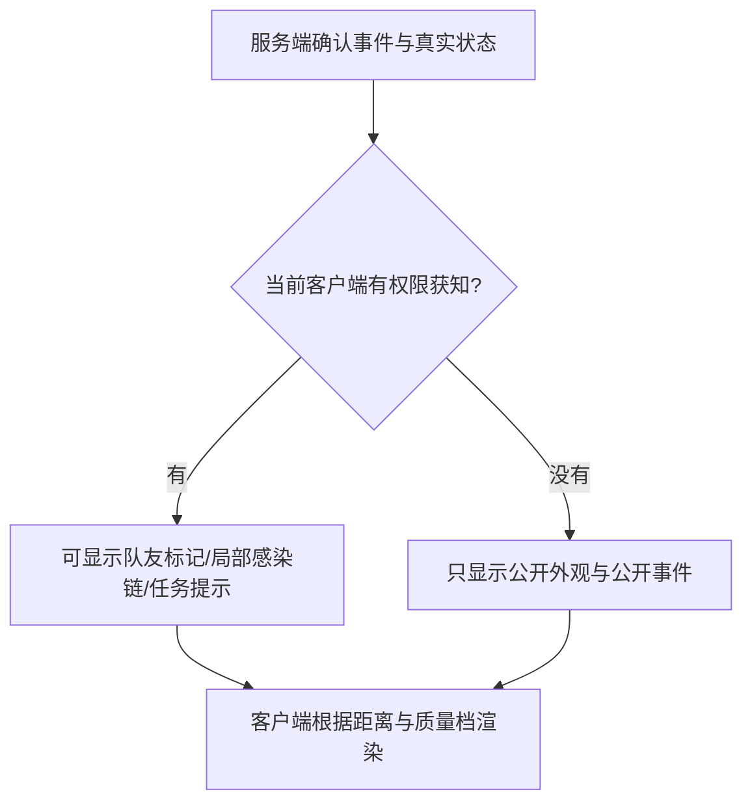
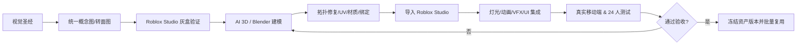

# 《断链》BREAK THE CHAIN — 视觉圣经（Visual Bible）

> **文档版本**：V1.0 · 首版制作基线  
> **更新日期**：2026-10-24  
> **项目类型**：Roblox 多人末日感染对抗游戏  
> **玩家规模**：支持小规模开局；**单局人数上限 24 人**  
> **目标平台**：Roblox PC / 手机优先兼容，平板其次  
> **生产方式**：Roblox Studio + Luau + Blender + AI 图像/3D 工具 + Codex/Claude  
> **适用读者**：游戏策划、美术、技术美术、AI 资产 Agent、UI/VFX 设计师、Roblox 开发 Agent  
> **状态**：制作规范；玩法与数值细节以独立的 Game Design Bible 为准

---

## 0. 一页式执行结论

### 0.1 视觉定位（一句话）

**一座正在失控的近未来末日城市里，玩家的身份和阵营会突然翻转；“感染链断裂、整群丧尸由红转绿”是整个游戏最鲜明的视觉记忆。**

### 0.2 美术风格决定

- **主风格**：风格化半写实 3D（Stylized Realism），人物和建筑有可信结构，但几何形体和材质细节做适度简化。
- **基调**：阴冷的末日城市、雨后湿地面、被遗弃的医院、应急电力和雾霾；**压抑但可读**。
- **角色**：清楚可辨的剪影、适度夸张的动作、不依赖写实恐怖血浆；玩家仍能认出曾经的队友。
- **主视觉奇观**：关键感染节点被治愈 → 感染能量逐层断裂 → 多个玩家短暂转入断联状态 → 可能集体恢复 / 紧急重连。
- **UI 风格**：清晰的应急终端 / 地铁调度台语义，简洁、易读，避免霓虹科幻界面堆砌。
- **技术原则**：移动端可读性、24 人同屏性能、状态保密、公平竞技优先于画面复杂度。

### 0.3 三个不可妥协的视觉支柱

| 视觉支柱 | 玩家应立刻感受到的内容 | 决策检验 |
|---|---|---|
| **Readability / 清楚** | 一秒内分清公开状态的人类、丧尸、断联危险 | 手机小屏远距离对战能看懂吗？ |
| **Reversal / 逆转** | 断链和重连是一场可见的团队事件，而不是一个微小数字变化 | 旁观者看 5 秒片段能知道发生了翻盘吗？ |
| **Identity / 熟人异化** | 被感染者仍能看出是刚才那个朋友 | 感染后是否保留足够的个人特征？ |

### 0.4 明确不做（首版硬约束）

1. 不采用传统 2D 像素风，不强制使用 Roblox 默认方块人作为唯一视觉语言。
2. 不追求 UE5/电影级照片写实，不依赖高密度实时灯光、极高面数和满屏粒子。
3. 不出现写实内脏、肢解、喷溅血浆、残肢特写及重度血腥效果。
4. 不让地图暗到必须不断调亮屏幕才能看清敌人。
5. 不始终显示 24 名玩家之间的感染连线；只在有权限、与当前交互相关的场景中显示局部关系。
6. 不仅凭红/绿颜色区分状态；**轮廓、动画、形状、图标、文本**需提供冗余信息。
7. 不把 AI 生成概念图直接当作可上线的 3D 游戏资产；必须经历清模、UV、材质、导入与实机验收。

---

## 1. 玩家场景与视觉叙事

### 1.1 世界观视觉设定

- **时代**：近未来、现实世界稍微先进的城市，不是赛博朋克。
- **地点**：封锁中的海湾城市「灰港」（**暂定场景代号**，避免过早锁死剧情）。
- **灾变**：感染让人类出现攻击性异化，并通过玩家传播形成感染链。画面上用“高对比侵蚀纹理 + 瞬时能量网络”代表其超常机制。
- **现存文明**：自动门、地铁屏蔽门、应急广播、诊疗仪器、断续电网、临时路障仍能互动。
- **情绪曲线**：开局警惕 → 尸潮扩散 → 关键节点暴露 → 断链逆转 → 紧急撤离。

### 1.2 四张应当出现在宣传中的关键画面

| 画面 ID | 画面叙事 | 主体构图 | 美术任务 |
|---|---|---|---|
| KEY-01 | 朋友即将尸变 | 近景人物一半处于人类状态、一半露出异化纹路 | 保留人物身份，感染变化明显 |
| KEY-02 | 丧尸逼近医院走廊 | 前景少量人类背影、中景丧尸、远景红色警报灯 | 清楚的敌我层次与逃生方向 |
| KEY-03 | **关键节点断链（封面主场面）** | 画面中心一名被治愈者，数条能量路径断裂，周围多个丧尸亮起金色断联轮廓 | 第一眼看出“整群逆转” |
| KEY-04 | 断联者争分夺秒重连 | 两名丧尸冲向彼此，计时环即将归零，后方人类追击 | 强动作感与清晰的时间压力 |

> KEY-03 是游戏的主视觉资产优先级 P0：先完成游戏内可读版本，再制作高画质宣传版本。**宣传图不得表现游戏实际没有的玩法**。

---

## 2. 色彩语言与 Design Tokens

### 2.1 核心色板

| Token | HEX | 语义 | 常见应用 |
|---|---|---|---|
| `BG_NIGHT` | `#151E27` | 深夜背景 | 天空、深处室内、主菜单深底 |
| `SURFACE_SLATE` | `#283542` | 旧工业设施 | 墙壁、UI 卡片、设备外壳 |
| `SURFACE_CONCRETE` | `#667783` | 湿冷混凝土 | 地铁/医院大面材质 |
| `TEXT_PRIMARY` | `#F2F5F6` | 核心信息 | UI 正文、倒计时 |
| `TEXT_SECONDARY` | `#B5C3CC` | 次级文字 | 操作提示、辅助描述 |
| `HUMAN_CYAN` | `#4CC9D9` | **公开人类状态** | HUD 阵营、治疗辅助光、战术提示 |
| `ZOMBIE_RED` | `#E85664` | **公开丧尸状态** | 公开尸变纹路、敌方提示、感染事件 |
| `CHAIN_AMBER` | `#F2B84B` | **断链/不稳定** | 断联倒计时、断裂连线、危险状态 |
| `CURE_MINT` | `#79D8A6` | **治愈/恢复** | 净化波纹、恢复反馈、成功信息 |
| `NEUTRAL_WHITE` | `#DDE6EB` | 中性系统信息 | 交互轮廓、地图引导 |
| `EXIT_BLUEWHITE` | `#D9F2FF` | 撤离/安全出口 | 白色光柱、方向箭头、出口标识 |

**使用要求**：状态色只在代表其明确语义的系统中强烈使用。环境可以有红色应急灯，但其色相、闪烁节奏和位置必须与丧尸轮廓区分；不要把整张地图浸在红光里。

### 2.2 配色比例（指导值）

- **65%** 低饱和环境色：炭灰、蓝灰、泥灰。
- **25%** 材质和局部环境色：锈色、米白瓷砖、暗绿医疗区。
- **10%** 状态高亮与重要交互色：青 / 红 / 金 / 绿。

这是风格倾向，不是每帧必须严格统计的像素占比。

### 2.3 除了颜色，还要用这些形状表达状态

| 状态 | 形状语言 | 动作/动画 | 文字与图标 |
|---|---|---|---|
| 人类 | 平滑双弧、完整环 | 稳定呼吸、警惕回头 | `HUMAN` / 人形盾牌 |
| 丧尸 | 尖角、不规则裂纹 | 前倾、不稳定抽动、扑咬 | `INFECTED` / 生化符号 |
| 断联 | 断开的线段、倒计时扇形 | 间歇顿挫、闪烁 | `DISCONNECTED` / 断链符号 |
| 治愈 | 向外扩展的圆环、收束光点 | 恢复站姿、平滑呼吸 | `CURED` / 十字+回环 |
| 重连 | 两段折线重新扣合 | 有方向性的能量回流 | `RECONNECTED` / 连接符号 |

> 目的：即使是色觉差异玩家、低画质模式或手机压缩视频，也能识别事件。

### 2.4 建议的 Luau Token 源文件

在项目内建立统一颜色模块（值可以后续微调，但名称应稳定）：

```lua
-- ReplicatedStorage/Shared/VisualTokens.luau
local T = {}
T.Color = {
    Night = Color3.fromRGB(21, 30, 39),
    Human = Color3.fromRGB(76, 201, 217),
    Zombie = Color3.fromRGB(232, 86, 100),
    Disconnected = Color3.fromRGB(242, 184, 75),
    Cured = Color3.fromRGB(121, 216, 166),
    TextPrimary = Color3.fromRGB(242, 245, 246),
    TextSecondary = Color3.fromRGB(181, 195, 204),
}
return T
```

---

## 3. 角色设计规范（最重要的实体资产）

### 3.1 角色比例与识别原则

**统一战斗轮廓，但保留玩家身份特征。**

- 角色采用 Roblox Humanoid / 兼容化身的适当绑定流程；优先保证移动、翻越、扑咬、注射动作的骨骼适配。
- 首版选择 **偏写实的风格化人体比例**，手脚可轻微放大，让跑动和扑咬更容易辨认。
- 角色外轮廓必须在 15～20 米场景距离仍能区分两阵营的公开状态。
- 允许保留一定的玩家发型、面部和识别性服装元素；不要求每人永久变成同一套制服。
- 对遮挡视线的大型配件、发光翅膀、夸张比例等在对局中采用合理限制或标准化展示，以免遮挡扑咬判定与阵营识别。
- 公平竞技需要规范化碰撞与实际判定区域；任何可售外观都不得改变有效碰撞范围。

### 3.2 人类角色（Human）

**关键词**：普通人、临时避难、轻度装备、疲惫但机敏。

- 服装：连帽防雨外套、工装裤、轻量防护背心、运动鞋、口罩等。
- 质感：中等粗糙度布料、脏旧橡胶、轻微磨损；避免军事特种部队的统一重装外形。
- 配色：灰蓝、暗橄榄、砂色、中性灰，少量青色反光/信号带。
- 剪影：头部与肩线清楚，双臂通常不前伸、重心相对直立。
- 可读标志：公开可见的人类 HUD 图标与适当青色辅助标记；不是全身常亮青光。

### 3.3 感染者角色（Infected）

**关键词**：**熟人异化**、动作异常、红色裂纹、不靠恶心血腥制造恐怖。

外形约束：

1. 保留角色发型或头面特征的一部分，以便队友认出“这原本是某某玩家”。
2. 保留原服装的主体颜色/轮廓，并局部增加破损、侵蚀、皱褶，不做整套替换成统一怪物皮。
3. 增加明显的前倾姿势、肩颈张力、非对称手臂动作；**动作比纹理更重要**。
4. 感染纹理为抽象发光裂纹 / 硬化皮肤斑块，不表现开放性伤口、内脏或真实血浆。
5. 近距离表现丰富细节；远距离靠姿态和局部高亮轮廓识别。

### 3.4 状态与身份保密矩阵（设计约束）

| 实际状态 | 自己看到 | 其他人类看到 | 丧尸盟友看到 | 全球公开场景 |
|---|---|---|---|---|
| 正常人类 | 人类 HUD | 人类外观 | 人类外观 | 人类外观 |
| **潜伏感染（尚未公开尸变）** | 私人感染 HUD / 倒计时 | **人类外观、无特异光效** | 按玩法权限，可收到私有队友标记 | 不泄露隐藏身份 |
| 公开感染 | 丧尸操作 HUD | 丧尸外形、红色破碎轮廓 | 丧尸外形 / 队友标签 | 丧尸外形 |
| 断联不稳定 | 金色倒计时 / 重连指引 | 可观察的金色破裂信号 | 金色断联状态与重连目标 | 可观察但不显示秘密感染树 |
| 已治愈 | 人类 HUD + 恢复反馈 | 人类状态与净化效果 | 失去已治愈盟友标记 | 人类状态 |

**关键规则**：如果保留“潜伏感染”的玩法，潜伏者本人知情不等于所有玩家知情。真实阵营信息应按玩法授权下发，不得因角色特效、默认玩家列表、名称颜色或 UI 无意泄露。视觉规范需要和服务端状态权限一起验收。

---

## 4. 核心视觉：感染链、断链、重连

### 4.1 感染链不是持续存在的“满屏光缆”

设计目标：玩家**理解链在发挥作用**，但不必时刻看到整棵树。

- 默认：感染树关系不常驻渲染，避免 24 人连线互相交叉。
- 发生感染的 0.4～0.8 秒内：在攻击者与被感染者间出现短暂红色脉冲，强调感染方向。
- 扫描设备触发时：仅向有权限的人类显示 **局部可扫描目标**、关键节点图标和简化的“下游规模”。
- 丧尸战术模式：允许查看与自身队伍有关的局部父子关系和断联分支（最终权限以玩法圣经为准）。
- 治愈关键节点时：只对受影响者及附近可见的玩家显示分支断裂，不展示地图外或不在视野内的全部人物之间连接线。
- 远距离/墙后：用合规的方向提示或事件列表替代透墙的精确路径渲染，不无意增加敌方透视能力。

### 4.2 关键事件 VFX 规范

| ID | 事件 | 建议时长 | 必须清楚表达 | 视觉构成 | 音效搭配 |
|---|---|---:|---|---|---|
| `VFX_BITE` | 咬中/感染成立 | 0.35～0.7 s | 发生感染 | 短冲击 + 侵蚀裂纹从接触点扩散 | 干脆冲击与一声短促低频 |
| `VFX_REVEAL` | 潜伏结束、公开尸变 | 0.8～1.3 s | 此人正式成为可辨丧尸 | 姿态突变 + 红色碎裂弧形 + 一次性轮廓强化 | 反向吸气 + 断裂声 |
| `VFX_SCAN` | 扫描目标 | 0.6～1.2 s | 关键目标与关联规模 | 扇形扫描 / 规则化 HUD 标记 | 雷达脉冲 |
| `VFX_CHAIN_CUT` | 枢纽被治愈 | 1.2～2 s | **局势逆转** | 金色裂断源点 → 短距离沿可见关系扩散 → 多人断联提示 | 断弦 + 层叠断裂声 |
| `VFX_UNSTABLE` | 断联等待重连 | 按玩法倒计时 | 时间紧迫但仍可救 | 金色破碎环、递减段数、明确倒计时 | 加速心跳/细脉冲 |
| `VFX_RELINK` | 成功重连 | 0.5～0.9 s | 链接恢复 | 两段金色连线扣合 → 红色能量回流 | 清晰的金属扣合声 |
| `VFX_CURE` | 最终恢复人类 | 0.8～1.4 s | 从感染者变回人类 | 侵蚀纹理退去、绿色波纹、回归直立站姿 | 温和净化音 |

> 时长均为**制作起始值**，需根据打击反馈、同屏密度、移动端录屏反复调整；具体断联秒数读取玩法配置，不能写死在粒子资源里。

### 4.3 《断链》最重要的 5 秒视觉脚本

```text
T+0.0s  人类使用解药命中枢纽 B；B 身上红色侵蚀纹路收束。
T+0.3s  B 身上出现一圈金色裂断环，听到明确的断链声。
T+0.7s  可见范围内的 D、E 身上先后出现琥珀色断联碎片。
T+1.2s  D、E 进入“断联倒计时”状态；可立刻跑向其他稳定感染者。
T+2.0s  人类开始追捕断联者，丧尸队友开始救援和重连。
T+5.0s  有人完成重连，另有人面临恢复；战局继续变化。
```

**不能做成**：一针命中后屏幕立即全绿、被转化者毫无操作、画面出现 24 条满屏连线。戏剧性来自“断链引发一场可操作的救援竞赛”。

### 4.4 特效层次优先级

1. **最高**：本机被咬 / 断联倒计时 / 治愈 / 阵营变化；永远不能被其他玩家特效遮住。
2. **高**：当前视野内距离较近的关键节点断链、重连成功。
3. **中**：普通队友公开感染、附近目标扫描。
4. **低**：远处普通扑咬、重复环境烟雾、雨水、火花。

同屏发生大量事件时，按优先级减少粒子和光效，不可削减关键文字、图标与交互确认。

### 4.5 信息可见性：与视觉一致的公平规则



- **禁止**为图省事，把隐藏感染树完整复制到每个客户端，再仅靠 UI 隐藏；客户端获得的数据需按授权最小化。
- **禁止**透视式标出对手所有隐藏感染节点。
- **禁止**通过屏幕上方全局人类/丧尸统计泄露潜伏感染者数量；如显示人数，明确标为“公开感染者”或选择只显示仍在场玩家总数。
- 观战模式不得绕过信息权限向正在对局的队友泄露秘密情报；首版可以采用有限观战或延迟观战。

---

## 5. 第一张地图：医院—街道—地铁（视觉布局）

### 5.1 地图视觉目标

**紧凑、有回环、辨方向、能追逐；适配从较少人数到 24 人满局。**

- 地图主主题：雨后的「灰港紧急医疗片区」。
- 主地标 A：**医院入口** — 医疗蓝白灯，救治设施主要视觉母题。
- 主地标 B：**中央十字路口** — 路灯、路障、路面箭头，追逐与遭遇的主舞台。
- 主地标 C：**地铁撤离站** — 白色出口灯与简化的环形列车标志。
- 次地标 D：**停车楼** — 黄色导向线、垂直坡道、上下层追逐。
- 次地标 E：**控制室** — 清楚的雷达/天线外形，承担扫描功能。

### 5.2 结构草图（不是最终关卡）

```text
           [医院与诊疗区] ---- [控制室]
                 |               |
            [小型庭院] ---- [中央街口] ---- [停车楼]
                 |               |             |
                 +--------- [地铁入口] --------+
                                |
                           [撤离站台]
```

- 至少形成两条自然追逐循环，不让任何避难点只有单一路径。
- 用不同的 **建筑形体 + 灯光色温 + 标识形状** 导航，不能仅靠小地图。
- 对小规模局：用合理的路障、关门和临时封锁缩小可玩区域；不要突然出现显眼空气墙。
- 对满 24 人局：开放侧街、停车楼和部分地铁连廊，降低过度拥挤。
- 地形和门洞要先按相机、玩家体型、扑咬操作验证，之后才进行美术覆盖。

### 5.3 环境资产语言

| 资产类 | 风格规则 | 制作策略 |
|---|---|---|
| 医院内饰 | 大块米白瓷砖、深蓝扶手、局部污渍 | 模块化墙板 / 门框 / 柜台 |
| 街道外立面 | 混凝土、锈蚀金属、局部碎窗 | 重复模块+变体贴花 |
| 地铁设施 | 高对比方向指示、白蓝 LED、简化金属结构 | 可复用护栏/闸机/标识 |
| 路障与可交互门 | 清晰边界和碰撞形体 | 强调可交互与装饰对象的区别 |
| 废墟杂物 | 小规模聚类摆放、避免密集遮挡 | 以复用件和整体组合作为主 |
| 雾、雨、火花 | 近景少量、局部使用 | 低质量档可关闭或减少 |

### 5.4 交互元素和不可交互元素区别

- 可交互：可读的实体形状 + 轻微脉冲轮廓（靠近时）+ 明确操作图标。
- 不可交互装饰：不使用与可交互门同一套高亮边框。
- 核心扫描设备、解药台和撤离装置必须有不同轮廓与不同声音。
- 在低画质时，也必须保留路标、出口箭头、互动提示和通道可达性。

---

## 6. 光影、材质与天气

### 6.1 光影目标

以 Roblox `Lighting`、`Atmosphere` 以及按需的 `ColorCorrectionEffect` / `BloomEffect` 制作氛围，但绝不能以牺牲战斗可见性为代价。

- **环境曝光**：确保阴影区也能看清人物轮廓和门洞；暗部有层次而不是纯黑。
- **引导光**：医院青白、控制室中性白、地铁出口蓝白；一眼看出移动目标。
- **红色警报灯**：可用于节奏高潮，但不能大面积覆盖丧尸身上的红色状态提示。
- **体积氛围**：优先使用合理的远处薄雾，避免浓雾掩盖远距离追逐。
- **Bloom**：仅对特殊高亮与湿地反射作轻度处理；低端设备可减弱。
- **景深/运动模糊**：对追逐中的主要游戏画面默认关闭或极弱，避免看不清人。

### 6.2 材质策略

- 地面采用较低频的大形体污渍，远看能识别路线；不使用过强的高频噪声贴图。
- PBR 主要用于**近景英雄资产**和关键地标，大多数道具可用简化材质与可复用纹理。
- 湿地面营造氛围，但无需大面积昂贵的反射假象。
- 玩家角色的感染裂纹应用局部遮罩与动态颜色，避免为每个状态复制多套高分辨率模型。

### 6.3 三种氛围时间片

| 时间片 | 氛围 | 目的 |
|---|---|---|
| 早局 | 薄雾蓝灰、残余晨光/夜色 | 让玩家快速认路 |
| 感染加剧 | 应急灯断续、局部远景烟尘 | 提升紧张感，但仍保持辨识度 |
| 撤离阶段 | 地铁白色引导灯亮起、广播灯闪烁 | 指导玩家向目标移动 |

> 环境变化要**局部且克制**，避免全屏闪光、强烈闪烁与眩晕，提供低特效/低闪烁选项。

---

## 7. UI/HUD 视觉规范

### 7.1 信息层级

| 等级 | 信息 | 常态表现 |
|---|---|---|
| P0 | 自己当前阵营、断联倒计时、生命/被攻击反馈、关键交互提示 | 常驻或强即时反馈 |
| P1 | 对局剩余时间、撤离目标、近距离感染威胁 | 清晰但不抢画面 |
| P2 | 公开阵营变化提示、救治次数、扫描结果 | 短时弹出，事件结束收起 |
| P3 | 分数、称号、挑战进度、商店入口 | 局外或短暂展示 |

### 7.2 HUD 布局（PC / 平板）

```text
┌──────────────────────────────────────────────────────┐
│ 当前任务/公开战况         06:12          小型设置按钮 │
│                                                      │
│                                                      │
│              [清晰的 3D 游戏画面]                    │
│                   + 中央轻量准星                     │
│                                                      │
│  自己阵营/状态                  扫描或动作提示          │
│  当前道具/次数                  感染/治疗反馈          │
└──────────────────────────────────────────────────────┘
```

- 顶部：倒计时、当前阶段和必要公开战况。
- 左侧：自我状态、道具剩余次数、简洁的生命/耐力信息。
- 右侧：可用操作与冷却；危险计时靠近角色或中心偏下（不遮挡瞄准）。
- 最多弹出 1 条高优先级全局通告；低优先级事件合并到小列表中。

### 7.3 手机横屏 HUD

- 以 Roblox 默认虚拟摇杆与跳跃控制占据区域为前提，在真实手机上迭代按钮位置。
- 交互按钮尽量靠近右手可触达区，但不与跳跃/镜头拖动冲突。
- 顶部安全区域内放计时与目标，避免刘海、打孔、圆角和系统手势区域。
- 断联倒计时是手机端 P0 信息：推荐在角色附近加可读的世界空间倒计时，同时在 HUD 给出数字/图标提示。
- 不能要求玩家频繁精确点选感染树节点；扫描与注射交互须有合理的辅助选取与近距离锁定机制。
- 所有核心操作均应考虑触控、键鼠与手柄可达性；手柄如非首发支持，也要明确告知而不是默认有效。

### 7.4 UI 尺寸与文字

以下数值为设计起点，**需通过设备实机截图验证**：

- 手机常态主要文字：等效 18～22 px 视觉高度起步；更小字号仅用于非关键二级信息。
- 核心倒计时/阵营变化：比普通正文更显著，至少具备大字和易认图标。
- 触控目标：常用虚拟按钮预留约 48～64 px 或更大的触控区域（依据屏幕密度调整）。
- 动态排版：优先使用相对布局与约束组件，不把 UI 写死成某一种 16:9 分辨率。
- 文字均存放在本地化资源/代码中，不要烘焙在贴图上。首版至少考虑中英文长度差异。

### 7.5 全局通知语法

建议使用短词 + 事件符号 + 必要数字，而不是占屏的大段字幕：

- `感染扩散 +1` / `INFECTION +1`
- `检测到关键节点` / `HUB DETECTED`
- `感染链断裂` / `CHAIN BROKEN`
- `断联：8` / `DISCONNECTED: 8`（实际值由服务器同步的剩余时间驱动）
- `重连成功` / `LINK RESTORED`
- `撤离窗口开启` / `EVACUATION OPEN`

> 局外可以展示完整感染树回放，便于复盘“谁感染了谁”；局内信息绝不能为了炫技泄露隐藏情报。

---

## 8. 动作、声音与打击反馈（服务于视觉）

### 8.1 必须先有的动作列表

| 动作 ID | 主体 | 视觉反馈重点 | P级 |
|---|---|---|---|
| `ANIM_HUMAN_RUN` | 人类 | 加速姿态清楚、转向响应快 | P0 |
| `ANIM_HUMAN_VAULT` | 人类 | 读得懂翻越起止点 | P1 |
| `ANIM_ZOMBIE_RUN` | 丧尸 | 前倾、步态更急促但不摇晃过度 | P0 |
| `ANIM_ZOMBIE_LUNGE` | 丧尸 | 明确前摇、冲刺方向、接触时机 | P0 |
| `ANIM_HUMAN_HIT` | 人类 | 清楚被击退，但不会长时间失控 | P0 |
| `ANIM_CURE_INJECT` | 人类 | 有读得懂的注射姿态与进度 | P0 |
| `ANIM_MUTATION` | 感染者 | 公开尸变和状态变化辨识 | P0 |
| `ANIM_RELINK` | 感染者 | 断联后朝稳定状态回归 | P1 |

### 8.2 音画一体设计

- 感染成立：干脆、清楚、方向可辨的短音，而不是长时间大音量恐怖音。
- 关键断链：**唯一可识别的三层音色**（清脆裂断 + 低频波纹 + 人群反应），在直播/短视频中也听得懂事件。
- 断联倒计时：节奏逐步加快，最后 2 秒增加明显的节拍变化；可关闭强烈音效但保留视觉提示。
- 重连：金属扣合/能量回流声；治愈：温和净化音；两个结果听觉上完全不同。
- 提供音量分组、减少屏幕闪烁选项，关键告警配字幕/视觉图标。

---

## 9. 24 人同屏性能与视觉预算

**注意：下表是本项目的初始目标/预算，不是 Roblox 官方强制上限。** 最终预算需在真实 Roblox 客户端、实际手机和 24 名角色同场景压力测试中回归调整。

### 9.1 目标设备与帧率

| 测试档位 | 建议基线 | 内部目标 |
|---|---|---|
| 低端 Android | 选定一台 4～6 GB RAM 的旧款中低端设备 | 满 24 人压力局尽量维持稳定 **≥30 FPS** |
| 普通 iPhone | 选一台较旧但仍符合 Roblox 当前支持范围的 iPhone | 24 人混战持续 **≥30 FPS** |
| 主流手机 | 近几年的中档 Android / iPhone | 优先达到 **45～60 FPS** |
| PC | 主流笔记本 / 桌面 | 优先达到 **60 FPS** |

**必须实测**平均帧率、1% low、卡顿峰值、内存峰值、加载耗时、发热、触控延迟；不能只报告平均 FPS。

### 9.2 单件资产建议起始预算

| 类型 | 起始预算建议 | 优化方向 |
|---|---|---|
| 战斗角色可控网格 | 尽量精简；从约 **4k～10k tris/角色** 的自制网格目标开始评估 | 根据 Avatar 附件、装备和距离 LOD 调整，不把此值当成强制硬上限 |
| 小道具 | 常见约 100～1,500 tris | 复用模型、少材质槽 |
| 关键设施 | 常见约 1k～6k tris | 近景才做细节、减少拆分 |
| 普通道具纹理 | 256～512 px 常见档位 | 优先复用材质、贴图图集 |
| 角色/重要设施纹理 | 512～1024 px 作为起始上限讨论 | 只有近景必要才用更高档 |
| 常规环境粒子 | 少量、局部、按档位缩放 | 降低透明叠层及远处粒子 |
| 断链 VFX | 以当前视野中的关键人物为主 | 多次事件合并；特效池复用 |

真实角色包含玩家自带头像与饰品，不能保证模型总面数天然受控；因此项目更关注**整帧成本、饰品处理策略与游戏内最终效果**。

### 9.3 特效质量档

| 效果 | 低画质 | 中画质 | 高画质 |
|---|---|---|---|
| 感染命中 | 轮廓+短动画 | +少量裂纹粒子 | +更完整局部裂纹 |
| 断链 | 金色标记+倒计时 | +近距离短连线 | +可见角色短暂分支波纹 |
| 治愈 | 绿色圆环 | +短粒子 | +局部材质收束 |
| 雾/雨 | 减少或关闭 | 局部 | 局部增强 |
| 环境光效 | 静态引导为主 | 少量动态光 | 受控动态光 |

**任何档位**都不能删除影响玩法理解的状态图标、倒计时数字、提示方向和动作前摇。

### 9.4 24 人视觉压力测试场景

1. 24 人同时出现在中央路口；摄像机从各方向扫过。
2. 同一秒内：3 次扑咬、2 次公开感染、1 次扫描。
3. 关键节点被治愈，6～10 人进入断联状态，部分人紧接着重连。
4. 地铁撤离时 15 人拥挤在狭窄入口，观察遮挡与 UI 覆盖。
5. 低画质、暗场、烟雾、色觉差异模拟下重复以上测试。

**视觉验收标准**：任何压力局中，玩家本人状态/倒计时不会丢失；重要敌人姿态可读；关键音画反馈不会引发持续严重卡顿。

---

## 10. AI 美术生产流水线（供 Codex/Claude 编排）

### 10.1 正确的生产顺序



### 10.2 AI Agent 分工建议

| Agent | 负责事项 | 必须输出 |
|---|---|---|
| Art Director Agent | 检查整体风格一致性、差异化、参考版权 | 美术规范审核记录与例外批准 |
| Concept Agent | 场景 moodboard、角色正侧背视图、事件 storyboard | 带 Prompt 和版本号的概念图 |
| 3D Asset Agent | 生成/修模/减面/拆 UV、导出 3D 文件 | `.blend` 源文件 + `.fbx`/`.gltf` 等导入文件 |
| Roblox Integration Agent | 导入、修材质、绑定、脚本接入、灯光 | 可复现的 Studio 场景与导入日志 |
| UI/VFX Agent | HUD、感染状态、断链/重连效果 | UI Prefab、特效资产及状态映射表 |
| QA Agent | 对照本规范截图、对比色板、压测 | 问题清单、性能报告、设备截图 |

> 不要求一定建立六个独立的模型实例，可以由一个主 Coding Agent 依次执行不同 Skill；关键是**交付标准固定**。

### 10.3 目录组织建议

```text
break-the-chain/
├── docs/
│   ├── visual-bible.md
│   ├── gameplay-bible.md                 # 第二份文档，另行编写
│   ├── asset-manifest.csv
│   └── qa-visual-checklist.md
├── art/
│   ├── references/                       # 仅使用具备合法授权的参考
│   ├── concepts/
│   │   ├── characters/
│   │   ├── environments/
│   │   └── keyframes/
│   ├── source-blender/
│   ├── exports/
│   │   ├── characters/
│   │   ├── environments/
│   │   └── props/
│   └── vfx/
├── src/
│   ├── shared/VisualTokens.luau
│   ├── client/
│   └── server/
└── tests/
    ├── screenshots/
    ├── perf/
    └── visual-regressions/
```

**推荐命名**：`BC_<类别>_<资产名>_<变体>_v###`，例如：

- `BC_CHR_Human_Runner_A_v001.fbx`
- `BC_CHR_Zombie_Runner_A_v001.fbx`
- `BC_ENV_Hospital_DoorFrame_A_v001.glb`
- `BC_PROP_MedicalScanner_A_v001.fbx`
- `BC_VFX_ChainCut_Ring_A_v001.png`
- `BC_UI_Disconnected_Icon_A_v001.png`

### 10.4 Asset Manifest 必填字段

| 字段 | 说明 |
|---|---|
| `asset_id` | 唯一业务命名，不依赖模型临时名称 |
| `category` | Character / Environment / Prop / UI / VFX / Audio |
| `source` | AI 工具 / 人工 / 自制 / 外部授权来源 |
| `license` | 可商用依据、限制、证明文件 |
| `prompt_version` | AI 生成使用的提示词版本 |
| `scale_ref` | 与标准人物、门高、走廊宽度的比例关系 |
| `tris_count` | 导出网格的三角面数 |
| `texture_resolution` | 纹理档位和贴图数量 |
| `material_slots` | 材质槽数量 |
| `rig_type` | 静态 / Humanoid / 自定义绑定 |
| `import_verified` | Roblox Studio 成功导入、材质和动画检查 |
| `perf_tier` | Low / Medium / High 质量档是否适用 |
| `review_status` | Draft / QA / Approved / Rejected |

### 10.5 从 Blender 或 AI 3D 到 Roblox 的验收门槛

1. 导入比例与坐标正确，主轴、朝向一致；不要靠每个实例在 Studio 里随机缩放补救。
2. 交互模型必须使用可靠的碰撞构造，不把高精度视觉网格直接等同于碰撞几何。
3. 角色 Rig 能正确执行奔跑、扑咬、注射和转换动作，无异常扭曲和穿模。
4. UV 不严重拉伸；PBR/基础贴图在 Studio 中实际显示正确，不能只在 Blender 中好看。
5. 重复场景模块使用同一 mesh/texture 资源 ID，避免无谓打断 Roblox 的实例化优化。
6. 非关键小道具提供简化版本；远景尽量减少透明叠加。
7. 上传/导入须通过平台审核；记录资源来源及可商用授权。

**导入格式说明**：Roblox Studio 官方 Importer 支持 `.fbx`、`.obj`、`.gltf`，并处理 `.glb` glTF 层级；角色/动画/材质导入差异需要逐项检查，不能假设 AI 3D 工具生成后可无损直接运行。

---

## 11. 可复用 AI 美术 Prompt（中英文生产模板）

> 原则：生成概念图、转面参考和资产草案时使用。**不要把一张 2D 图片误认为已经拥有可工作的几何、UV 和角色骨骼。**

### 11.1 全局 Style Prefix（每份图像/3D 概念提示必须继承）

```text
Project: BREAK THE CHAIN, a competitive multiplayer zombie-infection game on Roblox.
Art direction: stylized realistic 3D, grounded post-apocalyptic urban environment,
clear readable silhouettes, modular geometry, restrained weathering,
cinematic cool-blue atmospheric lighting with readable midtones,
muted charcoal/slate/concrete palette, selective cyan/red/amber/mint gameplay accents,
credible but simplified materials, polished real-time game art,
clean visual hierarchy, mobile-friendly readability, no photorealistic gore,
no text labels baked into images, no copyrighted character likenesses.
```

### 11.2 人类角色概念图

```text
[STYLE PREFIX]
Character turnaround sheet: young adult urban survivor, practical lightweight raincoat,
workwear pants, worn sneakers, compact utility belt, subtle cyan reflective detail,
recognizable silhouette, slightly stylized proportions,
front / side / back views, neutral A-pose for modeling reference,
clean studio-neutral backdrop, consistent scale, readable textures,
not heavily armored, no exaggerated anime features.
```

### 11.3 同一角色的感染版

```text
[STYLE PREFIX]
Use the same survivor identity and outfit silhouette as the reference character.
Create a transformed infected variant with forward-leaning posture,
asymmetric arm tension, subtle non-graphic hardened skin patches,
sharp crimson infection fissures, preserved hair and core outfit features.
Provide front / side / back views and one dynamic lunge pose.
The player must remain recognizable as their former human self.
No blood, no exposed wounds, no dismemberment.
```

### 11.4 废弃医院场景

```text
[STYLE PREFIX]
Environment concept: abandoned coastal city emergency hospital entrance,
wet concrete, broken wayfinding signs, restrained overgrowth,
blue-white medical beacon, one amber service lamp,
clear walkable lanes and cover positions, modular door frames,
readable visibility at medium distance,
third-person multiplayer gameplay camera, not a movie poster,
no dense fog hiding silhouettes, no excessive tiny debris.
```

### 11.5 断链招牌视觉 Keyframe

```text
[STYLE PREFIX]
Gameplay keyframe for 'chain severed' moment in an infected multiplayer match:
a cured central former-infected character with a mint cleansing ring,
several nearby infected characters showing amber fractured link symbols,
a short crimson network dissolving into segmented amber arcs,
clear readable character silhouettes, strong but restrained effects,
visible sense of multiple players switching tactical roles,
wide 16:9 composition, in-engine achievable real-time VFX look,
NOT endless laser lines between every character, no graphic violence.
```

### 11.6 通用 Negative Prompt / 拒绝项

```text
photorealistic gore, exposed organs, dismemberment, blood fountains,
excessive darkness, extremely dense volumetric fog, noisy micro-details,
overblown bloom, chromatic aberration, unreadable silhouettes,
complex sci-fi holographic clutter, illegible text, giant branded logos,
existing Roblox game IP characters, copyrighted franchise designs,
full-screen red lighting, overdecorated accessories obstructing gameplay.
```

### 11.7 AI Agent 必须反馈的质量检查

每个批次提交 `asset_id`、参考图、正侧背/关键角度、主尺寸、纹理档位、导入截图、性能档位、版权来源和与本圣经不一致的点。不允许只输出一句“看起来不错”。

---

## 12. 游戏封面、缩略图、宣传视觉

### 12.1 视觉主张

**“一针断链，整个阵营逆转。”** 这是面向潜在玩家的视觉信息核心。

- 封面主体：感染枢纽被治愈的一瞬间，红色感染人群出现琥珀色断联光效；前景 1 名人类行动主体，远景为末日医院/地铁。
- 色彩：暗蓝环境 + 红色感染群 + 金色断裂节点 + 绿色净化焦点。
- 游戏名称：`BREAK THE CHAIN`；中文可用 `断链`，对外标题须根据 Roblox 商店展示和商标查重确定。
- 品牌符号：一条裂开的“连接环”与断开的感染链；不要直接使用医疗十字作为唯一 Logo。

### 12.2 宣传物料包（玩法验证后制作）

1. 16:9 游戏内主视觉 1 张。
2. 正方形 / 平台要求比例的图标 1 版（按 Roblox 当期官方规范导出）。
3. 10 秒无解说玩法视频：公开感染 → 传播链扩大 → 枢纽被治愈 → 集体断联 → 某人重连反扑。
4. 3 张真实游戏实机截图：人类逃跑、扫描节点、关键断链。
5. 1 张精简状态解释图，用于新手说明和创作者社媒。

**注意**：概念图用于内部美术方向和合规宣传初期参考，但游戏页面的展示应真实反映玩法；不能把概念效果当成现有实机功能欺骗玩家。

---

## 13. 视觉 QA 与验收标准

### 13.1 硬性阻断项（任何一项不通过都不得批量生产）

- [ ] 人类、公开感染者、断联者在低画质下能通过轮廓/动作/图标区分。
- [ ] 潜伏感染者在无授权情况下不会通过光效、名牌、特效或统计数泄露身份。
- [ ] 手机横屏核心按钮不和摇杆、跳跃、系统安全区域冲突。
- [ ] 玩家在激烈追逐时仍能找到撤离路线与关键交互物。
- [ ] 24 人压力场景中关键断联计时不被特效淹没。
- [ ] 感染和治愈没有不可接受的血腥、肢解或现实伤害内容；正式发布时如实完成 Roblox 内容成熟度问卷。
- [ ] 角色、材质、动画通过 Roblox Studio 导入和真实客户端测试。
- [ ] AI/外部来源素材具备可商用授权记录，不含未经授权的明显 IP 复制。

### 13.2 可量化的内部可用性实验（建议起始目标）

| 测试 | 方法 | 起始目标（内部目标，非行业标准） |
|---|---|---|
| 阵营识别 | 10 名测试玩家看 15 米/20 米对战录屏 | **≥90%** 正确区分公开感染者与人类 |
| 断链理解 | 不讲解，展示 5 秒断链片段 | **≥80%** 能说出“多人感染状态开始改变” |
| 手机 HUD | 6 名移动端用户试玩 | **≥90%** 能在 2 秒内找到自己当前状态 |
| 目标导航 | 新玩家在医院—地铁灰盒玩一局 | 大多数玩家能够依靠环境标识到达目标，无需语音指导 |
| 性能 | 24 人拥挤+断链特效 | 低端基线设备争取 **≥30 FPS**，记录 1% low 和卡顿 |
| 弱视觉条件 | 低亮度、低特效、色觉差异模拟 | 关键交互不依赖单一颜色 |

未达到指标时优先削减装饰性粒子、背景细节与过度光效，不削减核心图标和角色行动的清晰度。

### 13.3 截图回归矩阵

在每次大改动后固定机位采集：

- `Q01_hospital_day_low_mobile.png`
- `Q02_hospital_night_high_pc.png`
- `Q03_central_crossroad_24p_low_mobile.png`
- `Q04_infection_reveal_close_medium.png`
- `Q05_chaincut_6targets_low_mobile.png`
- `Q06_disconnected_countdown_colorblind.png`
- `Q07_reconnect_vs_cure_same_scene.png`
- `Q08_metro_exit_hud_safearea_mobile.png`

同一张截图要按状态、镜头位置、画质档、设备维度命名，便于 Codex/Claude 做人工辅助差异审查。

---

## 14. 实施里程碑：先样板、后批量

### Gate 0：锁定美术方向（1～2 天）

交付：本 Visual Bible、生成人类/感染者对照概念图、医院地标情绪图、色板与 4 个关键 VFX storyboard。  
**通过条件**：风格一致，核心事件可以用一句话和一帧图说明。

### Gate 1：Roblox 中的可运行灰盒（3～5 天，估算）

交付：灰盒医院、街口与地铁；一名人类角色、一名感染者、基本 HUD、两种画质设置。  
**通过条件**：玩法动作和地标可读；不以高画质掩盖场景设计缺陷。

### Gate 2：视觉垂直切片（约 1 周，估算）

交付：扑咬、公开尸变、扫描、关键断链、断联倒计时、重连、治愈全流程；一套统一材质；桌面与手机 HUD。  
**通过条件**：在真实 Roblox 客户端完成一段可录屏的“断链翻盘”，且操作状态没有信息泄露。

### Gate 3：多人压力验证（随玩法迭代）

交付：小规模到 24 人分档测试、低端机性能报告、截图回归结果。  
**通过条件**：达到最小可用性与性能目标，才开始批量生产地图/皮肤。

### Gate 4：正式美术资产生产（玩法确认后）

交付：模块化环境包、角色变体、资产管理清单、封面与游戏商店素材。  
**通过条件**：所有资产复用视觉风格和技术约束，无逐件自行修改风格。

**以上日期是理想化的小团队/AI 辅助开发参考，不代表项目一定能在该周期完成。**

---

## 15. 与后续玩法文档的接口（避免两个文档互相冲突）

本视觉圣经**负责规范如何看起来、如何让玩家看懂**；游戏机制必须从玩法文档读取，不应直接固定在美术资源中。

| 参数/接口 | 本文档需要什么 | 由哪份文档定义最终值 |
|---|---|---|
| `MaxPlayers` | HUD 能容纳最大 24 人；满局特效可伸缩 | Game Design Bible（当前确定上限 24） |
| `MinPlayers` | 小规模人数也能显示正确布局和提示 | Game Design Bible（待定具体下限） |
| `IncubationDuration` | 潜伏动画和私人倒计时可配置 | Game Design Bible |
| `DisconnectDuration` | 断联 HUD 动态读取秒数；当前讨论值为 8 秒 | Game Design Bible |
| `CureTargetLimit` | 多目标同时转变的视觉可伸缩 | Game Design Bible |
| `InfectionGraphPermission` | 谁能看到感染链信息 | Game Design Bible + Technical Design |
| `ScannedTargetVisibility` | 扫描可见范围、UI 精度与持续时间 | Game Design Bible |
| `ExtractionPhase` | 地铁导向灯、全局倒计时提示 | Game Design Bible |
| `QualityTier` | 特效分档与必要信息保留 | Technical Design |

目前待玩法圣经确认的设计争议：是否保留潜伏感染、首个感染源为 NPC 还是随机玩家、零号感染者可否治愈、最低开局人数、断联秒数、局内链关系公开权限、撤离胜利判据。**视觉方案需要兼容这些参数化变化，而不是在本文偷偷替它们定案。**

---

## 16. 完整制作任务单（可直接给 Codex / Claude）

### P0：立刻制作

- [ ] 建立视觉 Tokens 与文档目录。
- [ ] 输出统一风格 Moodboard（包括授权来源记录）。
- [ ] 输出 1 名人类与同一身份感染者的正/侧/背对照图。
- [ ] 在 Roblox Studio 完成 1 段医院走廊 + 门 + 地标灯的灰盒样板。
- [ ] 实现默认人类、公开感染、断联、治愈 4 种状态的 **非泄密** UI/外观切换。
- [ ] 制作 `VFX_CHAIN_CUT` 与 `VFX_UNSTABLE` 视觉原型。
- [ ] 采集 PC 和真实手机的固定机位截图，对照 QA 表审查。

### P1：验证核心品质

- [ ] 4～8 人先做状态可读性与视线测试，然后逐步扩大人数。
- [ ] 做人类/丧尸动作区分，至少有基础奔跑、扑咬、注射和转换。
- [ ] 医院—街道—地铁主环路补齐可交互设施。
- [ ] 进行 16 / 24 人感染、断联、重连、撤离的同屏压测。
- [ ] 完成低画质、色觉差异和移动端安全区测试。

### P2：玩法通过后执行

- [ ] 按模块库批量制作建筑及场景道具。
- [ ] 扩展角色服装变体与商业化外观，不改变碰撞与重要剪影。
- [ ] 制作统一图标库、音效库及局外战绩页面。
- [ ] 制作真实玩法截图、商品封面、游戏图标和 10 秒宣传视频。

**Agent 执行纪律**：每完成一项输出“资产路径 + 对照截图 + 与规范偏差 + 性能变化 + 是否通过验收”，不得仅标记任务 Done。

---

## 17. Roblox 官方参考（2026-10-24 核验）

> 以下为官方技术入口，用于在开发时核对当期引擎能力和政策。技术或审核规则可能更新，应以 Roblox 官方最新版本为准。

1. Studio 资源导入及格式：<https://create.roblox.com/docs/studio/importer>
2. 光照、Atmosphere 与环境效果：<https://create.roblox.com/docs/environment>
3. 后期处理效果：<https://create.roblox.com/docs/environment/post-processing-effects>
4. 性能设计：<https://create.roblox.com/docs/performance-optimization/design>
5. 渲染与实例化优化：<https://create.roblox.com/docs/performance-optimization/improve>
6. 移动端 UI 位置与大小：<https://create.roblox.com/docs/ui/position-and-size>
7. 内容成熟度与合规问卷：<https://create.roblox.com/docs/production/promotion/content-maturity>
8. Roblox 资产和外部 3D 文件导入工作流：<https://create.roblox.com/docs/art/accessories/creating-rigid/importing>

---

## 附录 A：制作团队一眼可查的 Do / Don't

| Do（必须） | Don't（不要） |
|---|---|
| 角色剪影清晰、动作信息明确 | 只靠全身红/绿发光分敌我 |
| 首张地图以路线、遭遇与地标为中心 | 先堆满废墟装饰和密雾 |
| 一次断链是清晰可见的事件 | 24 人常驻全图连线 |
| 感染后保留个人身份特征 | 让所有感染者成为同一模型 |
| 优先保证手机端 30 FPS 可玩 | 只在高端 PC 录画面 |
| AI 资产统一经过清模、UV、材质、审查 | 把 AI 概念图直接当成完成资产 |
| 事件信息严格按权限展示 | UI 隐藏却在客户端保留秘密阵营数据 |
| 风格化、非血腥的末日氛围 | 真实血腥、肢解、重度恐怖 |

## 附录 B：版本与决策记录

| 版本 | 日期 | 主要内容 |
|---|---|---|
| V1.0 | 2026-10-24 | 首次锁定美术方向、阵营与断链视觉语言、地图、UI、AI 资产流程、24 人适配要求 |

**下一版 V1.1 的触发条件**：完成真实客户端视觉样板并拿到手机及多人压力测试结果后，再修订美术预算与关键特效时长。
